# Earlier-method comparison on the project models

Fresh measured runs for the earlier learning strategies in **Tables V and VI** of [On-the-fly Modulation for Balanced Multimodal Learning](https://arxiv.org/html/2410.11582v1). These tables use the project's encoders, with the explicitly documented adaptations below.

**Scope:** Food-101 and MELD use the verified small archives committed in `demo_data/`. The full CSVs behind the older [benchmark report](RESULTS.md) are absent from the checkout. Synthetic uses a new 600/150/150 train/validation/test protocol. These fresh five-epoch results must not be merged numerically with the older 12/15-epoch benchmark or the paper's datasets.

All percentages are **mean ± sample standard deviation over seeds 0, 1, 2**. Differences are absolute percentage points (pp). Checkpoints are selected using validation accuracy; the held-out test set is evaluated once after selection. No test metrics are used for training, pilot weights, schedules, or checkpoint selection.

[Aggregate CSV](baseline_comparison.csv) · [Per-run JSON](baseline_comparison.json) · [Runtime and data hashes](baseline_environment.json) · [All classification metrics](baseline_classification_metrics.csv) · [All class-wise precision/recall/F1](baseline_classwise_metrics.csv)

## food101

Train/validation/test: **200/50/50**; classes: 10; epochs: 5; batch size: 16.

| Method | Test accuracy (%) | Test macro-F1 (%) | Δ vs no modulation (pp) | Measured run time (s) |
|---|---:|---:|---:|---:|
| Concatenation / no modulation | 38.67 ± 4.16 | 35.21 ± 5.13 | +0.00 | 6.1 |
| GBlending (offline adaptation) | 30.00 ± 5.29 | 26.36 ± 5.20 | -8.67 | 30.0 |
| ModDrop (feature adaptation) | 30.67 ± 5.03 | 25.59 ± 3.18 | -8.00 | 5.3 |
| Dropout | 37.33 ± 1.15 | 33.85 ± 1.89 | -1.33 | 6.5 |
| Annealed dropout | 35.33 ± 9.45 | 31.79 ± 10.32 | -3.33 | 7.1 |
| Evolutional dropout | 34.67 ± 6.43 | 32.19 ± 6.41 | -4.00 | 6.3 |
| Curriculum dropout | 33.33 ± 4.16 | 28.99 ± 5.95 | -5.33 | 6.7 |
| OPM (project) | 26.67 ± 5.03 | 22.57 ± 5.00 | -12.00 | 6.7 |
| OGM-GE (project) | 39.33 ± 5.03 | 37.22 ± 6.00 | +0.67 | 9.8 |
| OPM + OGM-GE (project) | 26.67 ± 1.15 | 22.02 ± 1.51 | -12.00 | 7.5 |
| MMTM feature-level control | 28.00 ± 4.00 | 24.30 ± 2.70 | -10.67 | 5.4 |
| Greedy + MMTM (project adaptation) | 27.33 ± 3.06 | 23.65 ± 1.67 | -11.33 | 5.4 |

Greedy and its MMTM-only control have an additional cross-modal module. Their comparison isolates the Greedy training policy; comparisons with plain concatenation also include the architecture change. GBlending has auxiliary heads and three pilot fits; their cost is included in the time column.

### Project methods minus each older method

| Earlier method | OPM Δ (pp) | OGM-GE Δ (pp) | OPM + OGM-GE Δ (pp) |
|---|---:|---:|---:|
| GBlending (offline adaptation) | -3.33 | +9.33 | -3.33 |
| Greedy + MMTM (project adaptation) | -0.67 | +12.00 | -0.67 |
| ModDrop (feature adaptation) | -4.00 | +8.67 | -4.00 |
| Dropout | -10.67 | +2.00 | -10.67 |
| Annealed dropout | -8.67 | +4.00 | -8.67 |
| Evolutional dropout | -8.00 | +4.67 | -8.00 |
| Curriculum dropout | -6.67 | +6.00 | -6.67 |

Greedy minus MMTM-only control: **-0.67 pp** test accuracy.

### Graphs and confusion matrices

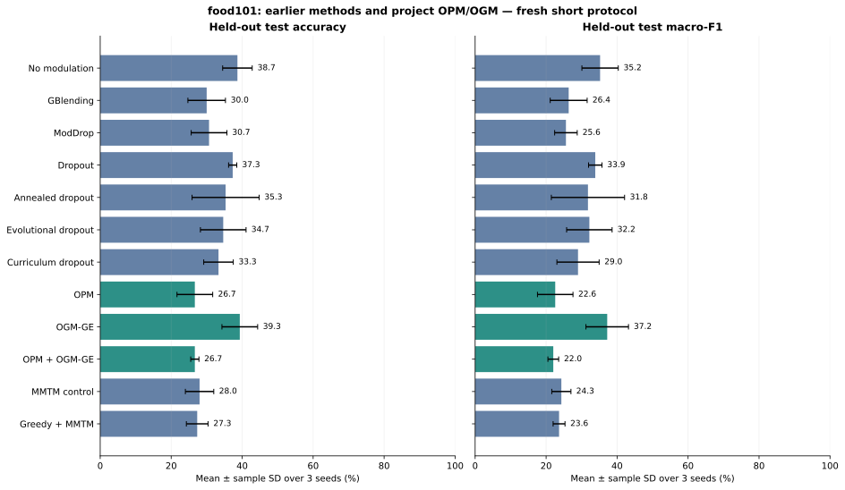

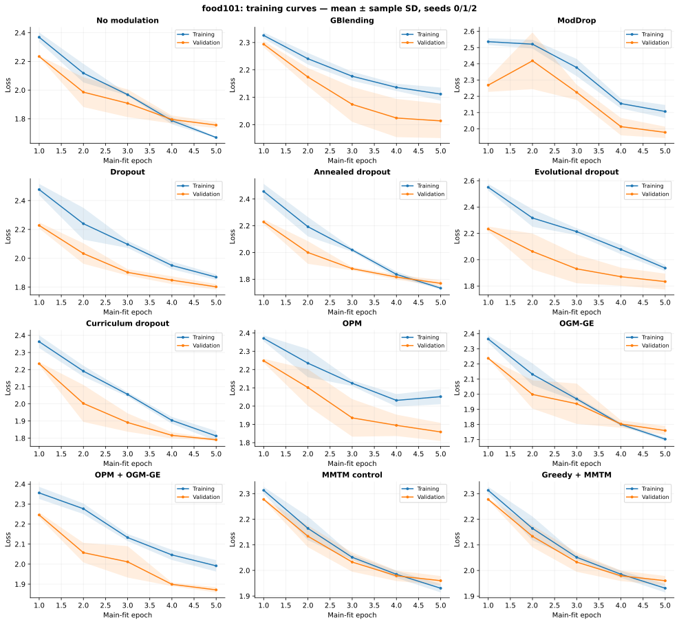

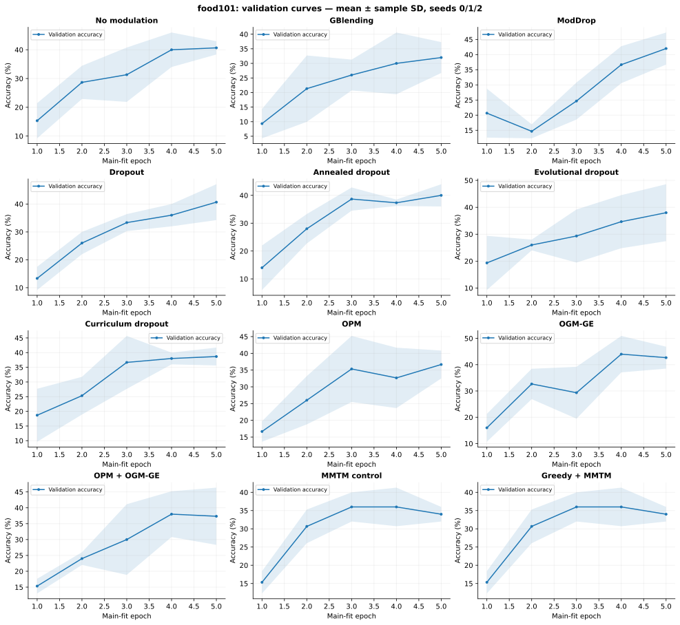

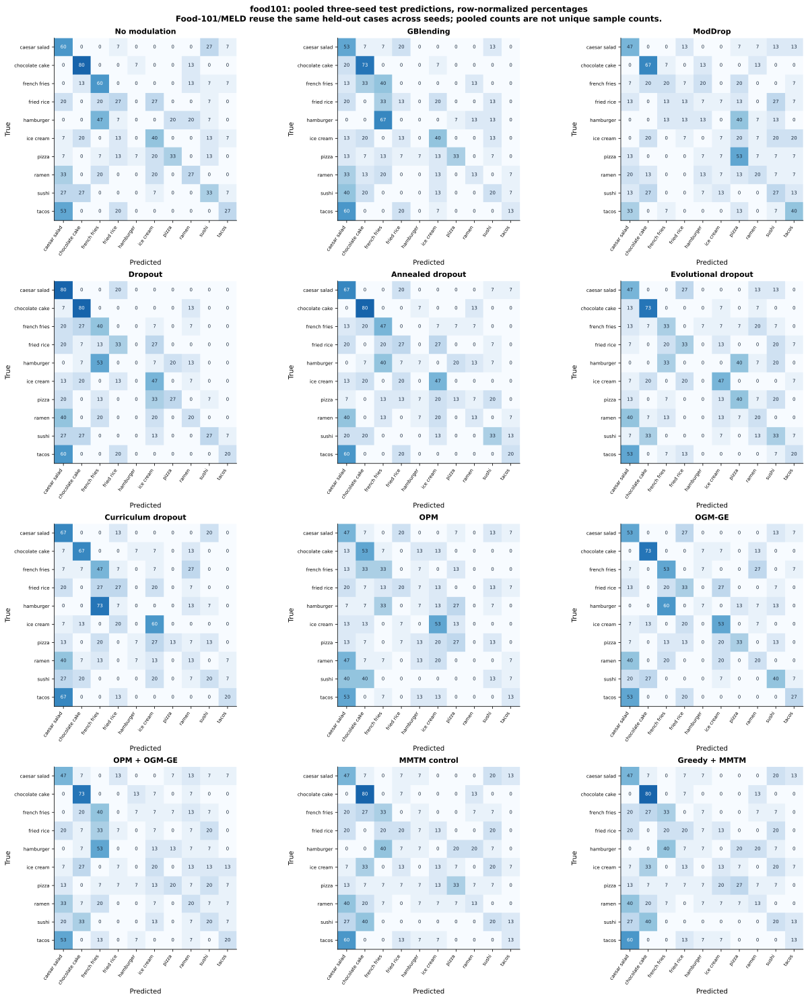

The evidence links below include an individual **count and normalized confusion matrix for every run**, plus accuracy, macro/micro/weighted F1, precision, recall, balanced accuracy and per-class support. Pooled Food-101/MELD matrices combine three models' predictions on the same test cases, rather than three independent test samples. Training loss for GBlending is its weighted auxiliary/fusion objective, while validation loss uses only its fusion classifier.

## meld

Train/validation/test: **350/70/70**; classes: 7; epochs: 5; batch size: 16.

| Method | Test accuracy (%) | Test macro-F1 (%) | Δ vs no modulation (pp) | Measured run time (s) |
|---|---:|---:|---:|---:|
| Concatenation / no modulation | 25.24 ± 1.65 | 22.07 ± 3.50 | +0.00 | 1.2 |
| GBlending (offline adaptation) | 24.29 ± 5.15 | 20.90 ± 6.97 | -0.95 | 6.2 |
| ModDrop (feature adaptation) | 20.95 ± 5.77 | 15.38 ± 7.09 | -4.29 | 1.3 |
| Dropout | 23.81 ± 4.36 | 19.53 ± 5.20 | -1.43 | 1.2 |
| Annealed dropout | 24.29 ± 1.43 | 20.25 ± 2.55 | -0.95 | 1.1 |
| Evolutional dropout | 24.29 ± 4.29 | 20.95 ± 2.86 | -0.95 | 1.2 |
| Curriculum dropout | 25.24 ± 3.30 | 22.43 ± 4.34 | +0.00 | 2.5 |
| OPM (project) | 21.43 ± 2.47 | 15.49 ± 4.45 | -3.81 | 3.4 |
| OGM-GE (project) | 26.67 ± 0.82 | 23.61 ± 1.45 | +1.43 | 2.7 |
| OPM + OGM-GE (project) | 26.19 ± 0.82 | 22.16 ± 3.13 | +0.95 | 3.4 |
| MMTM feature-level control | 28.10 ± 3.60 | 25.21 ± 4.48 | +2.86 | 2.4 |
| Greedy + MMTM (project adaptation) | 27.14 ± 2.47 | 25.73 ± 4.97 | +1.90 | 1.4 |

Greedy and its MMTM-only control have an additional cross-modal module. Their comparison isolates the Greedy training policy; comparisons with plain concatenation also include the architecture change. GBlending has auxiliary heads and three pilot fits; their cost is included in the time column.

### Project methods minus each older method

| Earlier method | OPM Δ (pp) | OGM-GE Δ (pp) | OPM + OGM-GE Δ (pp) |
|---|---:|---:|---:|
| GBlending (offline adaptation) | -2.86 | +2.38 | +1.90 |
| Greedy + MMTM (project adaptation) | -5.71 | -0.48 | -0.95 |
| ModDrop (feature adaptation) | +0.48 | +5.71 | +5.24 |
| Dropout | -2.38 | +2.86 | +2.38 |
| Annealed dropout | -2.86 | +2.38 | +1.90 |
| Evolutional dropout | -2.86 | +2.38 | +1.90 |
| Curriculum dropout | -3.81 | +1.43 | +0.95 |

Greedy minus MMTM-only control: **-0.95 pp** test accuracy.

### Graphs and confusion matrices

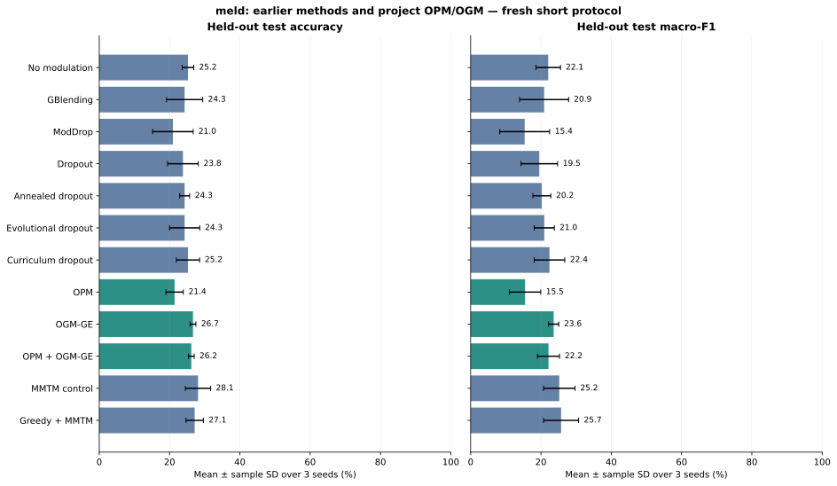

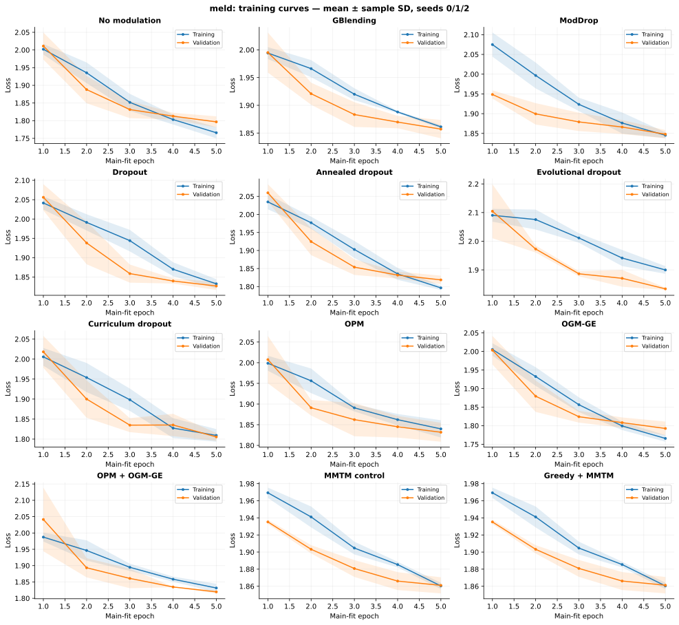

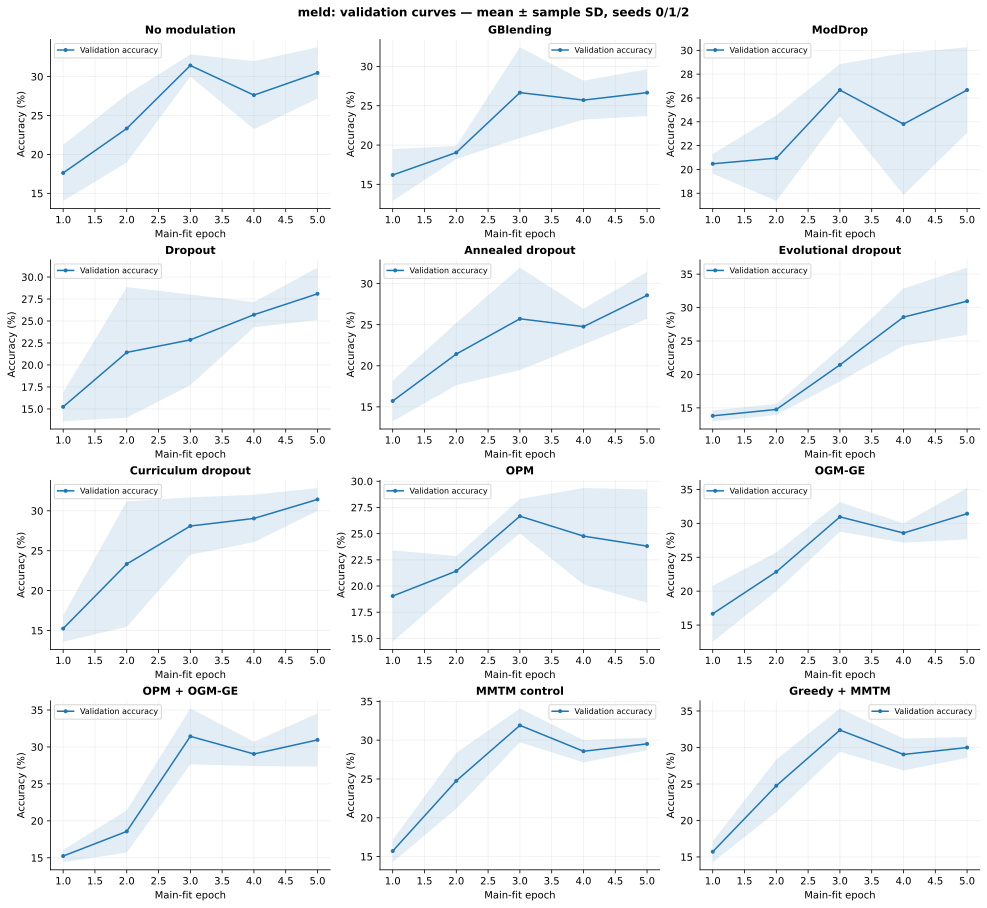

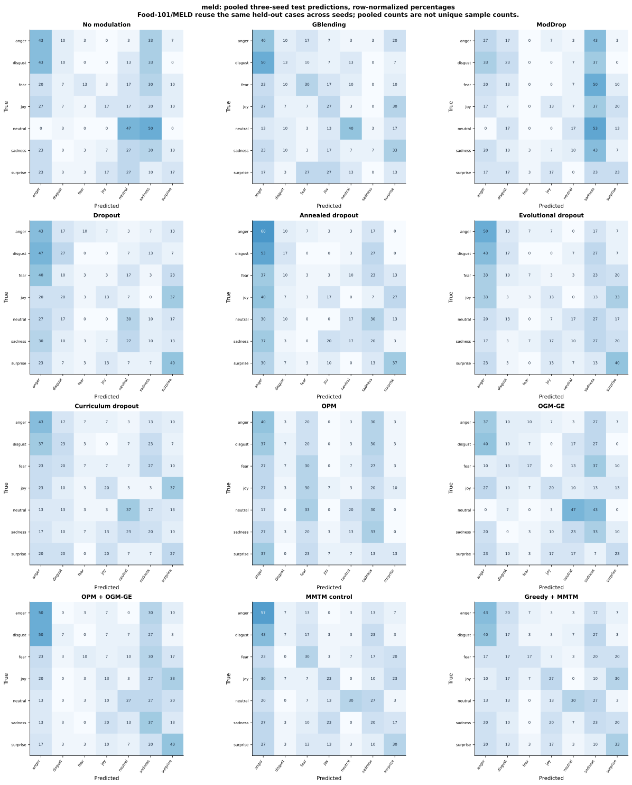

The evidence links below include an individual **count and normalized confusion matrix for every run**, plus accuracy, macro/micro/weighted F1, precision, recall, balanced accuracy and per-class support. Pooled Food-101/MELD matrices combine three models' predictions on the same test cases, rather than three independent test samples. Training loss for GBlending is its weighted auxiliary/fusion objective, while validation loss uses only its fusion classifier.

## synthetic

Train/validation/test: **600/150/150**; classes: 6; epochs: 5; batch size: 16.

| Method | Test accuracy (%) | Test macro-F1 (%) | Δ vs no modulation (pp) | Measured run time (s) |
|---|---:|---:|---:|---:|
| Concatenation / no modulation | 51.33 ± 5.70 | 49.06 ± 8.50 | +0.00 | 25.9 |
| GBlending (offline adaptation) | 17.78 ± 1.92 | 7.66 ± 3.19 | -33.56 | 94.4 |
| ModDrop (feature adaptation) | 70.00 ± 4.81 | 70.47 ± 4.38 | +18.67 | 23.7 |
| Dropout | 70.44 ± 7.67 | 70.51 ± 7.62 | +19.11 | 22.9 |
| Annealed dropout | 66.44 ± 10.12 | 66.91 ± 9.87 | +15.11 | 23.0 |
| Evolutional dropout | 70.22 ± 3.42 | 70.57 ± 3.53 | +18.89 | 23.2 |
| Curriculum dropout | 51.56 ± 17.52 | 50.03 ± 21.87 | +0.22 | 23.3 |
| OPM (project) | 59.56 ± 8.01 | 59.17 ± 7.26 | +8.22 | 21.1 |
| OGM-GE (project) | 62.67 ± 12.35 | 63.23 ± 12.38 | +11.33 | 23.1 |
| OPM + OGM-GE (project) | 62.00 ± 13.11 | 61.71 ± 13.85 | +10.67 | 21.6 |
| MMTM feature-level control | 45.11 ± 7.19 | 44.11 ± 9.38 | -6.22 | 20.1 |
| Greedy + MMTM (project adaptation) | 44.44 ± 6.58 | 42.89 ± 9.07 | -6.89 | 20.4 |

Greedy and its MMTM-only control have an additional cross-modal module. Their comparison isolates the Greedy training policy; comparisons with plain concatenation also include the architecture change. GBlending has auxiliary heads and three pilot fits; their cost is included in the time column.

### Project methods minus each older method

| Earlier method | OPM Δ (pp) | OGM-GE Δ (pp) | OPM + OGM-GE Δ (pp) |
|---|---:|---:|---:|
| GBlending (offline adaptation) | +41.78 | +44.89 | +44.22 |
| Greedy + MMTM (project adaptation) | +15.11 | +18.22 | +17.56 |
| ModDrop (feature adaptation) | -10.44 | -7.33 | -8.00 |
| Dropout | -10.89 | -7.78 | -8.44 |
| Annealed dropout | -6.89 | -3.78 | -4.44 |
| Evolutional dropout | -10.67 | -7.56 | -8.22 |
| Curriculum dropout | +8.00 | +11.11 | +10.44 |

Greedy minus MMTM-only control: **-0.67 pp** test accuracy.

### Graphs and confusion matrices

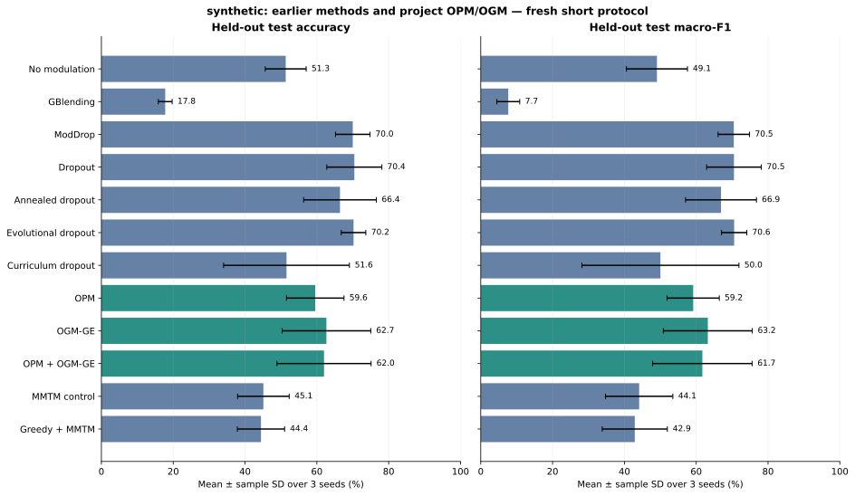

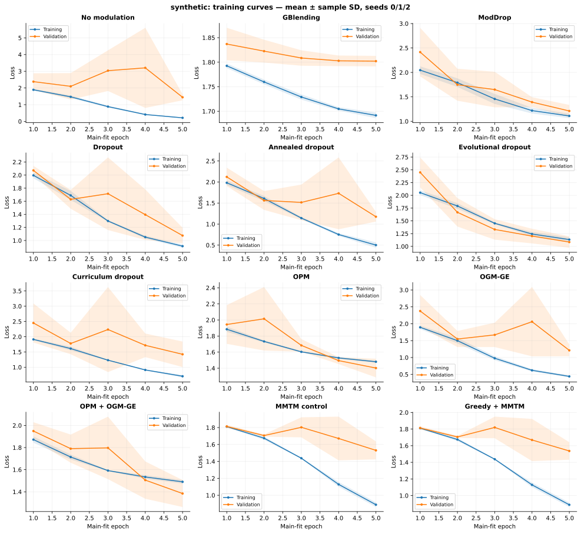

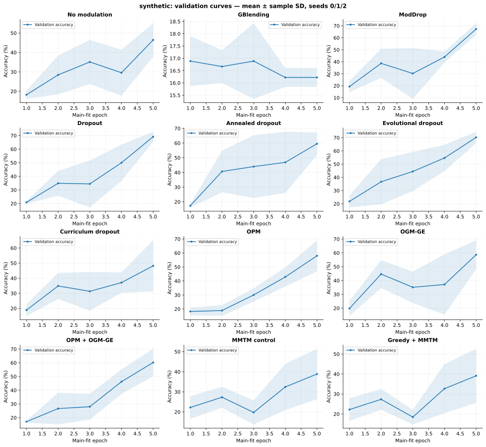

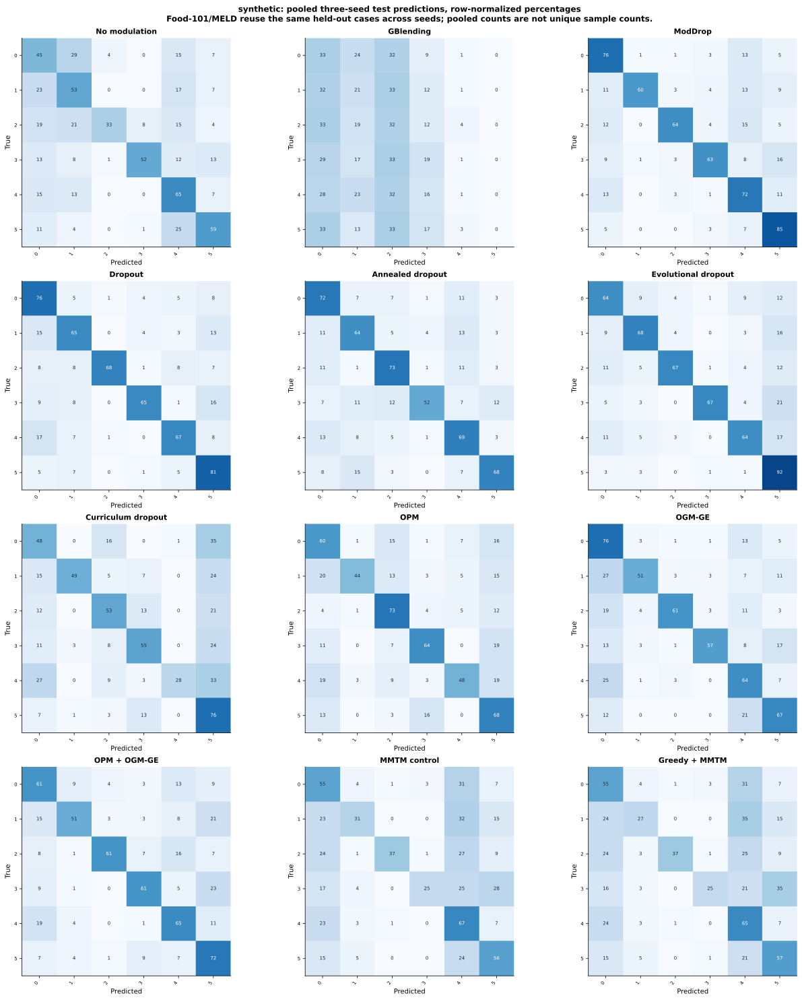

The evidence links below include an individual **count and normalized confusion matrix for every run**, plus accuracy, macro/micro/weighted F1, precision, recall, balanced accuracy and per-class support. Pooled Food-101/MELD matrices combine three models' predictions on the same test cases, rather than three independent test samples. Training loss for GBlending is its weighted auxiliary/fusion objective, while validation loss uses only its fusion classifier.

## Training protocol and implementation

- The common architecture is the existing SmallCNN (128-dimensional image features) or MELD audio MLP (300-dimensional input, 128-dimensional output), plus the existing one-layer, 64-dimensional text Transformer and linear concatenation classifier.
- All main fits use five epochs, batch size 16, SGD learning rate 0.01, momentum 0.9, weight decay 0.0001, cosine scheduling, two CPU threads, and all training rows. Encoders and fusion head start from exactly the same hashed initialization per dataset/seed. The loader has a separately seeded shuffle generator. Stochastic masks and augmentations can still differ as methods consume random numbers differently.
- Run times are CPU wall-clock observations including main fitting, validation, test evaluation, evidence/checkpoint writing and GBlending pilot work, after initial data/model construction. Some dataset sweeps ran concurrently. Treat these as execution evidence rather than a controlled speed benchmark.
- Food-101 has ten classes and label-derived prompt text: this measures a controlled shortcut/bias setting, not natural image-caption recognition. MELD has seven classes, real text, and official audio embeddings; official split boundaries are preserved. Both committed demo samples are balanced and small.
- Synthetic has six classes, informative-modality probabilities 0.7, image size 64 and noise standard deviation 1.0. The test base seed is `seed + 1_000_000` so it cannot duplicate the validation stream in the existing synthetic dataset class.
- OPM, OGM-GE and their combination use the existing project implementation unchanged (`q_base=lam=alpha=0.5`, Gaussian enhancement enabled). The paper labels its gradient method OGM; these project rows explicitly include GE.

| Earlier strategy | Exact project adaptation |
|---|---|
| GBlending | Offline independent unimodal/fusion pilot fits, each five epochs, from the initial weights. `G = val_loss_before - val_loss_after`; `O = (val-train)_after - (val-train)_before`; weights proportional to `max(G,0)/max(O²,1e-12)`. Uniform fallback if no pilot improves validation loss. Train-loss probes use evaluation transforms. Restore the initial model for the main weighted auxiliary/fusion CE fit. Positive-gain clipping and guards are explicit numerical adaptations; all pilot evidence is saved. |
| Greedy | One MMTM module on the final pooled vectors, bottleneck `2*(d1+d2)/4`, sigmoid gates. Accumulate squared-gradient/squared-parameter norms separately for encoder and shared-plus-modality gate parameters. Trigger curation when the difference of log10 bypass/main ratios exceeds 0.01; use five curation steps after two warmup epochs. Replace the selected modality's gate with its detached training-only running mean. Each modality has its own correct mean; evaluation never updates it. This final-feature module and project optimizer differ from the original multi-layer video architecture. |
| ModDrop | Independent per-sample, whole-feature-vector masks, fixed drop probability 0.5 and inverted scaling. Both modalities can be dropped. This is the modality-dropout component, without the original gesture model's pretraining/fusion curriculum. |
| Dropout | Independent feature-unit Bernoulli dropout, probability 0.5, before fusion. |
| Annealed dropout | Feature-unit dropout; probability decreases linearly from 0.5 to 0 over the main fit's optimization steps. |
| Evolutional dropout | Mini-batch feature RMS defines multinomial probabilities; draw `k=round(D*(1-0.5))` units with replacement per sample and scale counts by `1/(k*p_j)`. Detached probability estimates, zero-feature fallback, and denominator guards. |
| Curriculum dropout | Feature-unit dropout; probability increases as `0.5*(1-exp(-5*t/(T-1)))`, from zero toward 0.5. The horizon rate is fixed in advance. |

These settings are fixed before evaluating test results. They are transparent project adaptations, not exact reproductions of the original authors' architectures or hyperparameter searches.

## Coverage of the reference paper

| Paper comparison | Status in this project |
|---|---|
| Tables V/VI: GBlending, Greedy, ModDrop and four neuron dropout methods | Fresh measured project adaptations above, alongside concatenation, OPM, OGM-GE and the combination. |
| Table II: Summation and FiLM | Architecture comparisons; not implemented/evaluated in this update. Concatenation is the existing project's fusion architecture. |
| Table III: CentralNet, VATT, MMTM | A final-feature MMTM control is measured for Greedy. Original CentralNet, VATT and multi-layer MMTM architectures are not reproduced. |
| Tables VIII/IX: I-vector, X-vector, MWTSM, TSN, TSM | Require the paper's audio/video inputs and task-specific architectures; not evaluated on these stored image/text and embedding samples. |
| Table VII: AVGA, AVSDN, PSP, AVSD, PanoAVQA | Event-localization or question-answering models; their tasks/data/metrics do not match these classification experiments. |

No unavailable score is filled in as an experimental result. The main table covers the paper's directly comparable learning strategies; it does not claim every architecture in the paper has been trained here.

## Paper-reported reference values (different datasets)

Accuracy/mAP percentages from Tables V, VI and XII, provided as a literature reference. They are **reported by the paper**, not measured by this repository. No improvement is computed between these cells and Food-101, MELD or synthetic results.

| Method | CREMA-D Acc / mAP | Kinetics-Sounds Acc / mAP | UCF-101 Acc / mAP | Source table |
|---|---:|---:|---:|---|
| Concatenation | 66.9 / 72.1 | 63.0 / 67.3 | 80.5 / 86.4 | V/VI |
| GBlending | 72.0 / 78.6 | 67.5 / 72.1 | 80.9 / 86.6 | V |
| Greedy | 68.4 / 76.8 | 65.2 / 69.6 | 80.9 / 86.9 | V |
| ModDrop | 69.9 / 77.6 | 65.9 / 71.8 | 81.4 / 87.2 | VI |
| Dropout | 66.5 / 71.8 | 62.8 / 66.1 | 80.3 / 85.8 | VI |
| Annealed dropout | 65.3 / 70.9 | 62.1 / 65.2 | 80.1 / 84.7 | VI |
| Evolutional dropout | 65.9 / 72.0 | 62.4 / 65.7 | 80.4 / 86.1 | VI |
| Curriculum dropout | 64.9 / 70.2 | 61.9 / 64.9 | 79.9 / 84.3 | VI |
| OPM | 75.1 / 81.2 | 67.0 / 72.5 | 81.9 / 88.0 | V/VI |
| OGM | 74.6 / 81.4 | 65.4 / 71.4 | 81.5 / 87.6 | V/VI |
| OPM + OGM | 76.7 / 83.6 | 68.0 / 74.7 | 81.5 / 87.8 | XII |

## Reproduce

Run from `balanced_mm/` with the repository requirements installed:

```bash
python scripts/unpack_demo_data.py --dataset all --out data/verified_demo
python scripts/run_baseline_comparison.py --datasets food101 meld synthetic --seeds 0 1 2
python scripts/plot_baseline_comparison.py --results results
python scripts/make_baseline_report.py --results results
```

For larger prepared CSV datasets, change `--data-root`, training budget, and output directory explicitly; rerun all methods under that shared protocol. Best checkpoints are kept locally as ignored `.pt` files. Git contains configs, histories, pilot-loss evidence, predictions, confusion matrices, metric summaries and hashes.

## Primary sources

- [Reference paper, arXiv v1](https://arxiv.org/html/2410.11582v1) and [author implementation](https://github.com/GeWu-Lab/BML_TPAMI2024/tree/4b3aa4fd841856c4acbebf48549e6c59fbf7635e).
- [Gradient Blending, CVPR 2020](https://openaccess.thecvf.com/content_CVPR_2020/html/Wang_What_Makes_Training_Multi-Modal_Classification_Networks_Hard_CVPR_2020_paper.html), [Algorithm 1/2 PDF](https://arxiv.org/pdf/1905.12681).
- [Greedy multimodal learning, ICML 2022](https://proceedings.mlr.press/v162/wu22d.html), [author code inspected at a190e03](https://github.com/nyukat/greedy_multimodal_learning/tree/a190e03755bd8d0883b2c5c0cd7921d2561ce2ee).
- [ModDrop author paper](https://arxiv.org/abs/1501.00102).
- [Dropout, JMLR](https://jmlr.org/papers/v15/srivastava14a.html).
- [Annealed dropout, IBM Research](https://research.ibm.com/publications/annealed-dropout-training-of-deep-networks).
- [Improved Dropout for Shallow and Deep Learning](https://arxiv.org/abs/1602.02220).
- [Curriculum dropout, ICCV 2017](https://openaccess.thecvf.com/content_ICCV_2017/html/Morerio_Curriculum_Dropout_ICCV_2017_paper.html), [author code](https://github.com/pmorerio/curriculum-dropout).

## Run evidence

| Dataset | Seed | Method | Selected epoch (0-based) | Evidence |
|---|---:|---|---:|---|
| food101 | 0 | Concatenation / no modulation | 4 | [Metrics + confusion matrix](baseline_runs/food101_s0_none/classification_report.md) · [Config](baseline_runs/food101_s0_none/config.json) · [History](baseline_runs/food101_s0_none/history.json) · [Test predictions](baseline_runs/food101_s0_none/test_metrics.json) |
| food101 | 0 | GBlending (offline adaptation) | 4 | [Metrics + confusion matrix](baseline_runs/food101_s0_gblending/classification_report.md) · [Config](baseline_runs/food101_s0_gblending/config.json) · [History](baseline_runs/food101_s0_gblending/history.json) · [Test predictions](baseline_runs/food101_s0_gblending/test_metrics.json) · [Pilot](baseline_runs/food101_s0_gblending/pilot.json) |
| food101 | 0 | ModDrop (feature adaptation) | 4 | [Metrics + confusion matrix](baseline_runs/food101_s0_moddrop/classification_report.md) · [Config](baseline_runs/food101_s0_moddrop/config.json) · [History](baseline_runs/food101_s0_moddrop/history.json) · [Test predictions](baseline_runs/food101_s0_moddrop/test_metrics.json) |
| food101 | 0 | Dropout | 4 | [Metrics + confusion matrix](baseline_runs/food101_s0_dropout/classification_report.md) · [Config](baseline_runs/food101_s0_dropout/config.json) · [History](baseline_runs/food101_s0_dropout/history.json) · [Test predictions](baseline_runs/food101_s0_dropout/test_metrics.json) |
| food101 | 0 | Annealed dropout | 4 | [Metrics + confusion matrix](baseline_runs/food101_s0_annealed/classification_report.md) · [Config](baseline_runs/food101_s0_annealed/config.json) · [History](baseline_runs/food101_s0_annealed/history.json) · [Test predictions](baseline_runs/food101_s0_annealed/test_metrics.json) |
| food101 | 0 | Evolutional dropout | 4 | [Metrics + confusion matrix](baseline_runs/food101_s0_evolutional/classification_report.md) · [Config](baseline_runs/food101_s0_evolutional/config.json) · [History](baseline_runs/food101_s0_evolutional/history.json) · [Test predictions](baseline_runs/food101_s0_evolutional/test_metrics.json) |
| food101 | 0 | Curriculum dropout | 3 | [Metrics + confusion matrix](baseline_runs/food101_s0_curriculum/classification_report.md) · [Config](baseline_runs/food101_s0_curriculum/config.json) · [History](baseline_runs/food101_s0_curriculum/history.json) · [Test predictions](baseline_runs/food101_s0_curriculum/test_metrics.json) |
| food101 | 0 | OPM (project) | 4 | [Metrics + confusion matrix](baseline_runs/food101_s0_opm/classification_report.md) · [Config](baseline_runs/food101_s0_opm/config.json) · [History](baseline_runs/food101_s0_opm/history.json) · [Test predictions](baseline_runs/food101_s0_opm/test_metrics.json) |
| food101 | 0 | OGM-GE (project) | 3 | [Metrics + confusion matrix](baseline_runs/food101_s0_ogm/classification_report.md) · [Config](baseline_runs/food101_s0_ogm/config.json) · [History](baseline_runs/food101_s0_ogm/history.json) · [Test predictions](baseline_runs/food101_s0_ogm/test_metrics.json) |
| food101 | 0 | OPM + OGM-GE (project) | 3 | [Metrics + confusion matrix](baseline_runs/food101_s0_both/classification_report.md) · [Config](baseline_runs/food101_s0_both/config.json) · [History](baseline_runs/food101_s0_both/history.json) · [Test predictions](baseline_runs/food101_s0_both/test_metrics.json) |
| food101 | 0 | MMTM feature-level control | 2 | [Metrics + confusion matrix](baseline_runs/food101_s0_mmtm/classification_report.md) · [Config](baseline_runs/food101_s0_mmtm/config.json) · [History](baseline_runs/food101_s0_mmtm/history.json) · [Test predictions](baseline_runs/food101_s0_mmtm/test_metrics.json) |
| food101 | 0 | Greedy + MMTM (project adaptation) | 2 | [Metrics + confusion matrix](baseline_runs/food101_s0_greedy/classification_report.md) · [Config](baseline_runs/food101_s0_greedy/config.json) · [History](baseline_runs/food101_s0_greedy/history.json) · [Test predictions](baseline_runs/food101_s0_greedy/test_metrics.json) |
| food101 | 1 | Concatenation / no modulation | 3 | [Metrics + confusion matrix](baseline_runs/food101_s1_none/classification_report.md) · [Config](baseline_runs/food101_s1_none/config.json) · [History](baseline_runs/food101_s1_none/history.json) · [Test predictions](baseline_runs/food101_s1_none/test_metrics.json) |
| food101 | 1 | GBlending (offline adaptation) | 4 | [Metrics + confusion matrix](baseline_runs/food101_s1_gblending/classification_report.md) · [Config](baseline_runs/food101_s1_gblending/config.json) · [History](baseline_runs/food101_s1_gblending/history.json) · [Test predictions](baseline_runs/food101_s1_gblending/test_metrics.json) · [Pilot](baseline_runs/food101_s1_gblending/pilot.json) |
| food101 | 1 | ModDrop (feature adaptation) | 4 | [Metrics + confusion matrix](baseline_runs/food101_s1_moddrop/classification_report.md) · [Config](baseline_runs/food101_s1_moddrop/config.json) · [History](baseline_runs/food101_s1_moddrop/history.json) · [Test predictions](baseline_runs/food101_s1_moddrop/test_metrics.json) |
| food101 | 1 | Dropout | 3 | [Metrics + confusion matrix](baseline_runs/food101_s1_dropout/classification_report.md) · [Config](baseline_runs/food101_s1_dropout/config.json) · [History](baseline_runs/food101_s1_dropout/history.json) · [Test predictions](baseline_runs/food101_s1_dropout/test_metrics.json) |
| food101 | 1 | Annealed dropout | 2 | [Metrics + confusion matrix](baseline_runs/food101_s1_annealed/classification_report.md) · [Config](baseline_runs/food101_s1_annealed/config.json) · [History](baseline_runs/food101_s1_annealed/history.json) · [Test predictions](baseline_runs/food101_s1_annealed/test_metrics.json) |
| food101 | 1 | Evolutional dropout | 4 | [Metrics + confusion matrix](baseline_runs/food101_s1_evolutional/classification_report.md) · [Config](baseline_runs/food101_s1_evolutional/config.json) · [History](baseline_runs/food101_s1_evolutional/history.json) · [Test predictions](baseline_runs/food101_s1_evolutional/test_metrics.json) |
| food101 | 1 | Curriculum dropout | 2 | [Metrics + confusion matrix](baseline_runs/food101_s1_curriculum/classification_report.md) · [Config](baseline_runs/food101_s1_curriculum/config.json) · [History](baseline_runs/food101_s1_curriculum/history.json) · [Test predictions](baseline_runs/food101_s1_curriculum/test_metrics.json) |
| food101 | 1 | OPM (project) | 3 | [Metrics + confusion matrix](baseline_runs/food101_s1_opm/classification_report.md) · [Config](baseline_runs/food101_s1_opm/config.json) · [History](baseline_runs/food101_s1_opm/history.json) · [Test predictions](baseline_runs/food101_s1_opm/test_metrics.json) |
| food101 | 1 | OGM-GE (project) | 3 | [Metrics + confusion matrix](baseline_runs/food101_s1_ogm/classification_report.md) · [Config](baseline_runs/food101_s1_ogm/config.json) · [History](baseline_runs/food101_s1_ogm/history.json) · [Test predictions](baseline_runs/food101_s1_ogm/test_metrics.json) |
| food101 | 1 | OPM + OGM-GE (project) | 3 | [Metrics + confusion matrix](baseline_runs/food101_s1_both/classification_report.md) · [Config](baseline_runs/food101_s1_both/config.json) · [History](baseline_runs/food101_s1_both/history.json) · [Test predictions](baseline_runs/food101_s1_both/test_metrics.json) |
| food101 | 1 | MMTM feature-level control | 1 | [Metrics + confusion matrix](baseline_runs/food101_s1_mmtm/classification_report.md) · [Config](baseline_runs/food101_s1_mmtm/config.json) · [History](baseline_runs/food101_s1_mmtm/history.json) · [Test predictions](baseline_runs/food101_s1_mmtm/test_metrics.json) |
| food101 | 1 | Greedy + MMTM (project adaptation) | 1 | [Metrics + confusion matrix](baseline_runs/food101_s1_greedy/classification_report.md) · [Config](baseline_runs/food101_s1_greedy/config.json) · [History](baseline_runs/food101_s1_greedy/history.json) · [Test predictions](baseline_runs/food101_s1_greedy/test_metrics.json) |
| food101 | 2 | Concatenation / no modulation | 4 | [Metrics + confusion matrix](baseline_runs/food101_s2_none/classification_report.md) · [Config](baseline_runs/food101_s2_none/config.json) · [History](baseline_runs/food101_s2_none/history.json) · [Test predictions](baseline_runs/food101_s2_none/test_metrics.json) |
| food101 | 2 | GBlending (offline adaptation) | 3 | [Metrics + confusion matrix](baseline_runs/food101_s2_gblending/classification_report.md) · [Config](baseline_runs/food101_s2_gblending/config.json) · [History](baseline_runs/food101_s2_gblending/history.json) · [Test predictions](baseline_runs/food101_s2_gblending/test_metrics.json) · [Pilot](baseline_runs/food101_s2_gblending/pilot.json) |
| food101 | 2 | ModDrop (feature adaptation) | 4 | [Metrics + confusion matrix](baseline_runs/food101_s2_moddrop/classification_report.md) · [Config](baseline_runs/food101_s2_moddrop/config.json) · [History](baseline_runs/food101_s2_moddrop/history.json) · [Test predictions](baseline_runs/food101_s2_moddrop/test_metrics.json) |
| food101 | 2 | Dropout | 4 | [Metrics + confusion matrix](baseline_runs/food101_s2_dropout/classification_report.md) · [Config](baseline_runs/food101_s2_dropout/config.json) · [History](baseline_runs/food101_s2_dropout/history.json) · [Test predictions](baseline_runs/food101_s2_dropout/test_metrics.json) |
| food101 | 2 | Annealed dropout | 4 | [Metrics + confusion matrix](baseline_runs/food101_s2_annealed/classification_report.md) · [Config](baseline_runs/food101_s2_annealed/config.json) · [History](baseline_runs/food101_s2_annealed/history.json) · [Test predictions](baseline_runs/food101_s2_annealed/test_metrics.json) |
| food101 | 2 | Evolutional dropout | 2 | [Metrics + confusion matrix](baseline_runs/food101_s2_evolutional/classification_report.md) · [Config](baseline_runs/food101_s2_evolutional/config.json) · [History](baseline_runs/food101_s2_evolutional/history.json) · [Test predictions](baseline_runs/food101_s2_evolutional/test_metrics.json) |
| food101 | 2 | Curriculum dropout | 4 | [Metrics + confusion matrix](baseline_runs/food101_s2_curriculum/classification_report.md) · [Config](baseline_runs/food101_s2_curriculum/config.json) · [History](baseline_runs/food101_s2_curriculum/history.json) · [Test predictions](baseline_runs/food101_s2_curriculum/test_metrics.json) |
| food101 | 2 | OPM (project) | 2 | [Metrics + confusion matrix](baseline_runs/food101_s2_opm/classification_report.md) · [Config](baseline_runs/food101_s2_opm/config.json) · [History](baseline_runs/food101_s2_opm/history.json) · [Test predictions](baseline_runs/food101_s2_opm/test_metrics.json) |
| food101 | 2 | OGM-GE (project) | 4 | [Metrics + confusion matrix](baseline_runs/food101_s2_ogm/classification_report.md) · [Config](baseline_runs/food101_s2_ogm/config.json) · [History](baseline_runs/food101_s2_ogm/history.json) · [Test predictions](baseline_runs/food101_s2_ogm/test_metrics.json) |
| food101 | 2 | OPM + OGM-GE (project) | 4 | [Metrics + confusion matrix](baseline_runs/food101_s2_both/classification_report.md) · [Config](baseline_runs/food101_s2_both/config.json) · [History](baseline_runs/food101_s2_both/history.json) · [Test predictions](baseline_runs/food101_s2_both/test_metrics.json) |
| food101 | 2 | MMTM feature-level control | 3 | [Metrics + confusion matrix](baseline_runs/food101_s2_mmtm/classification_report.md) · [Config](baseline_runs/food101_s2_mmtm/config.json) · [History](baseline_runs/food101_s2_mmtm/history.json) · [Test predictions](baseline_runs/food101_s2_mmtm/test_metrics.json) |
| food101 | 2 | Greedy + MMTM (project adaptation) | 3 | [Metrics + confusion matrix](baseline_runs/food101_s2_greedy/classification_report.md) · [Config](baseline_runs/food101_s2_greedy/config.json) · [History](baseline_runs/food101_s2_greedy/history.json) · [Test predictions](baseline_runs/food101_s2_greedy/test_metrics.json) |
| meld | 0 | Concatenation / no modulation | 4 | [Metrics + confusion matrix](baseline_runs/meld_s0_none/classification_report.md) · [Config](baseline_runs/meld_s0_none/config.json) · [History](baseline_runs/meld_s0_none/history.json) · [Test predictions](baseline_runs/meld_s0_none/test_metrics.json) |
| meld | 0 | GBlending (offline adaptation) | 2 | [Metrics + confusion matrix](baseline_runs/meld_s0_gblending/classification_report.md) · [Config](baseline_runs/meld_s0_gblending/config.json) · [History](baseline_runs/meld_s0_gblending/history.json) · [Test predictions](baseline_runs/meld_s0_gblending/test_metrics.json) · [Pilot](baseline_runs/meld_s0_gblending/pilot.json) |
| meld | 0 | ModDrop (feature adaptation) | 4 | [Metrics + confusion matrix](baseline_runs/meld_s0_moddrop/classification_report.md) · [Config](baseline_runs/meld_s0_moddrop/config.json) · [History](baseline_runs/meld_s0_moddrop/history.json) · [Test predictions](baseline_runs/meld_s0_moddrop/test_metrics.json) |
| meld | 0 | Dropout | 4 | [Metrics + confusion matrix](baseline_runs/meld_s0_dropout/classification_report.md) · [Config](baseline_runs/meld_s0_dropout/config.json) · [History](baseline_runs/meld_s0_dropout/history.json) · [Test predictions](baseline_runs/meld_s0_dropout/test_metrics.json) |
| meld | 0 | Annealed dropout | 4 | [Metrics + confusion matrix](baseline_runs/meld_s0_annealed/classification_report.md) · [Config](baseline_runs/meld_s0_annealed/config.json) · [History](baseline_runs/meld_s0_annealed/history.json) · [Test predictions](baseline_runs/meld_s0_annealed/test_metrics.json) |
| meld | 0 | Evolutional dropout | 4 | [Metrics + confusion matrix](baseline_runs/meld_s0_evolutional/classification_report.md) · [Config](baseline_runs/meld_s0_evolutional/config.json) · [History](baseline_runs/meld_s0_evolutional/history.json) · [Test predictions](baseline_runs/meld_s0_evolutional/test_metrics.json) |
| meld | 0 | Curriculum dropout | 4 | [Metrics + confusion matrix](baseline_runs/meld_s0_curriculum/classification_report.md) · [Config](baseline_runs/meld_s0_curriculum/config.json) · [History](baseline_runs/meld_s0_curriculum/history.json) · [Test predictions](baseline_runs/meld_s0_curriculum/test_metrics.json) |
| meld | 0 | OPM (project) | 3 | [Metrics + confusion matrix](baseline_runs/meld_s0_opm/classification_report.md) · [Config](baseline_runs/meld_s0_opm/config.json) · [History](baseline_runs/meld_s0_opm/history.json) · [Test predictions](baseline_runs/meld_s0_opm/test_metrics.json) |
| meld | 0 | OGM-GE (project) | 4 | [Metrics + confusion matrix](baseline_runs/meld_s0_ogm/classification_report.md) · [Config](baseline_runs/meld_s0_ogm/config.json) · [History](baseline_runs/meld_s0_ogm/history.json) · [Test predictions](baseline_runs/meld_s0_ogm/test_metrics.json) |
| meld | 0 | OPM + OGM-GE (project) | 2 | [Metrics + confusion matrix](baseline_runs/meld_s0_both/classification_report.md) · [Config](baseline_runs/meld_s0_both/config.json) · [History](baseline_runs/meld_s0_both/history.json) · [Test predictions](baseline_runs/meld_s0_both/test_metrics.json) |
| meld | 0 | MMTM feature-level control | 2 | [Metrics + confusion matrix](baseline_runs/meld_s0_mmtm/classification_report.md) · [Config](baseline_runs/meld_s0_mmtm/config.json) · [History](baseline_runs/meld_s0_mmtm/history.json) · [Test predictions](baseline_runs/meld_s0_mmtm/test_metrics.json) |
| meld | 0 | Greedy + MMTM (project adaptation) | 2 | [Metrics + confusion matrix](baseline_runs/meld_s0_greedy/classification_report.md) · [Config](baseline_runs/meld_s0_greedy/config.json) · [History](baseline_runs/meld_s0_greedy/history.json) · [Test predictions](baseline_runs/meld_s0_greedy/test_metrics.json) |
| meld | 1 | Concatenation / no modulation | 2 | [Metrics + confusion matrix](baseline_runs/meld_s1_none/classification_report.md) · [Config](baseline_runs/meld_s1_none/config.json) · [History](baseline_runs/meld_s1_none/history.json) · [Test predictions](baseline_runs/meld_s1_none/test_metrics.json) |
| meld | 1 | GBlending (offline adaptation) | 4 | [Metrics + confusion matrix](baseline_runs/meld_s1_gblending/classification_report.md) · [Config](baseline_runs/meld_s1_gblending/config.json) · [History](baseline_runs/meld_s1_gblending/history.json) · [Test predictions](baseline_runs/meld_s1_gblending/test_metrics.json) · [Pilot](baseline_runs/meld_s1_gblending/pilot.json) |
| meld | 1 | ModDrop (feature adaptation) | 2 | [Metrics + confusion matrix](baseline_runs/meld_s1_moddrop/classification_report.md) · [Config](baseline_runs/meld_s1_moddrop/config.json) · [History](baseline_runs/meld_s1_moddrop/history.json) · [Test predictions](baseline_runs/meld_s1_moddrop/test_metrics.json) |
| meld | 1 | Dropout | 3 | [Metrics + confusion matrix](baseline_runs/meld_s1_dropout/classification_report.md) · [Config](baseline_runs/meld_s1_dropout/config.json) · [History](baseline_runs/meld_s1_dropout/history.json) · [Test predictions](baseline_runs/meld_s1_dropout/test_metrics.json) |
| meld | 1 | Annealed dropout | 4 | [Metrics + confusion matrix](baseline_runs/meld_s1_annealed/classification_report.md) · [Config](baseline_runs/meld_s1_annealed/config.json) · [History](baseline_runs/meld_s1_annealed/history.json) · [Test predictions](baseline_runs/meld_s1_annealed/test_metrics.json) |
| meld | 1 | Evolutional dropout | 4 | [Metrics + confusion matrix](baseline_runs/meld_s1_evolutional/classification_report.md) · [Config](baseline_runs/meld_s1_evolutional/config.json) · [History](baseline_runs/meld_s1_evolutional/history.json) · [Test predictions](baseline_runs/meld_s1_evolutional/test_metrics.json) |
| meld | 1 | Curriculum dropout | 3 | [Metrics + confusion matrix](baseline_runs/meld_s1_curriculum/classification_report.md) · [Config](baseline_runs/meld_s1_curriculum/config.json) · [History](baseline_runs/meld_s1_curriculum/history.json) · [Test predictions](baseline_runs/meld_s1_curriculum/test_metrics.json) |
| meld | 1 | OPM (project) | 2 | [Metrics + confusion matrix](baseline_runs/meld_s1_opm/classification_report.md) · [Config](baseline_runs/meld_s1_opm/config.json) · [History](baseline_runs/meld_s1_opm/history.json) · [Test predictions](baseline_runs/meld_s1_opm/test_metrics.json) |
| meld | 1 | OGM-GE (project) | 2 | [Metrics + confusion matrix](baseline_runs/meld_s1_ogm/classification_report.md) · [Config](baseline_runs/meld_s1_ogm/config.json) · [History](baseline_runs/meld_s1_ogm/history.json) · [Test predictions](baseline_runs/meld_s1_ogm/test_metrics.json) |
| meld | 1 | OPM + OGM-GE (project) | 4 | [Metrics + confusion matrix](baseline_runs/meld_s1_both/classification_report.md) · [Config](baseline_runs/meld_s1_both/config.json) · [History](baseline_runs/meld_s1_both/history.json) · [Test predictions](baseline_runs/meld_s1_both/test_metrics.json) |
| meld | 1 | MMTM feature-level control | 2 | [Metrics + confusion matrix](baseline_runs/meld_s1_mmtm/classification_report.md) · [Config](baseline_runs/meld_s1_mmtm/config.json) · [History](baseline_runs/meld_s1_mmtm/history.json) · [Test predictions](baseline_runs/meld_s1_mmtm/test_metrics.json) |
| meld | 1 | Greedy + MMTM (project adaptation) | 3 | [Metrics + confusion matrix](baseline_runs/meld_s1_greedy/classification_report.md) · [Config](baseline_runs/meld_s1_greedy/config.json) · [History](baseline_runs/meld_s1_greedy/history.json) · [Test predictions](baseline_runs/meld_s1_greedy/test_metrics.json) |
| meld | 2 | Concatenation / no modulation | 2 | [Metrics + confusion matrix](baseline_runs/meld_s2_none/classification_report.md) · [Config](baseline_runs/meld_s2_none/config.json) · [History](baseline_runs/meld_s2_none/history.json) · [Test predictions](baseline_runs/meld_s2_none/test_metrics.json) |
| meld | 2 | GBlending (offline adaptation) | 3 | [Metrics + confusion matrix](baseline_runs/meld_s2_gblending/classification_report.md) · [Config](baseline_runs/meld_s2_gblending/config.json) · [History](baseline_runs/meld_s2_gblending/history.json) · [Test predictions](baseline_runs/meld_s2_gblending/test_metrics.json) · [Pilot](baseline_runs/meld_s2_gblending/pilot.json) |
| meld | 2 | ModDrop (feature adaptation) | 2 | [Metrics + confusion matrix](baseline_runs/meld_s2_moddrop/classification_report.md) · [Config](baseline_runs/meld_s2_moddrop/config.json) · [History](baseline_runs/meld_s2_moddrop/history.json) · [Test predictions](baseline_runs/meld_s2_moddrop/test_metrics.json) |
| meld | 2 | Dropout | 4 | [Metrics + confusion matrix](baseline_runs/meld_s2_dropout/classification_report.md) · [Config](baseline_runs/meld_s2_dropout/config.json) · [History](baseline_runs/meld_s2_dropout/history.json) · [Test predictions](baseline_runs/meld_s2_dropout/test_metrics.json) |
| meld | 2 | Annealed dropout | 2 | [Metrics + confusion matrix](baseline_runs/meld_s2_annealed/classification_report.md) · [Config](baseline_runs/meld_s2_annealed/config.json) · [History](baseline_runs/meld_s2_annealed/history.json) · [Test predictions](baseline_runs/meld_s2_annealed/test_metrics.json) |
| meld | 2 | Evolutional dropout | 3 | [Metrics + confusion matrix](baseline_runs/meld_s2_evolutional/classification_report.md) · [Config](baseline_runs/meld_s2_evolutional/config.json) · [History](baseline_runs/meld_s2_evolutional/history.json) · [Test predictions](baseline_runs/meld_s2_evolutional/test_metrics.json) |
| meld | 2 | Curriculum dropout | 4 | [Metrics + confusion matrix](baseline_runs/meld_s2_curriculum/classification_report.md) · [Config](baseline_runs/meld_s2_curriculum/config.json) · [History](baseline_runs/meld_s2_curriculum/history.json) · [Test predictions](baseline_runs/meld_s2_curriculum/test_metrics.json) |
| meld | 2 | OPM (project) | 2 | [Metrics + confusion matrix](baseline_runs/meld_s2_opm/classification_report.md) · [Config](baseline_runs/meld_s2_opm/config.json) · [History](baseline_runs/meld_s2_opm/history.json) · [Test predictions](baseline_runs/meld_s2_opm/test_metrics.json) |
| meld | 2 | OGM-GE (project) | 2 | [Metrics + confusion matrix](baseline_runs/meld_s2_ogm/classification_report.md) · [Config](baseline_runs/meld_s2_ogm/config.json) · [History](baseline_runs/meld_s2_ogm/history.json) · [Test predictions](baseline_runs/meld_s2_ogm/test_metrics.json) |
| meld | 2 | OPM + OGM-GE (project) | 2 | [Metrics + confusion matrix](baseline_runs/meld_s2_both/classification_report.md) · [Config](baseline_runs/meld_s2_both/config.json) · [History](baseline_runs/meld_s2_both/history.json) · [Test predictions](baseline_runs/meld_s2_both/test_metrics.json) |
| meld | 2 | MMTM feature-level control | 2 | [Metrics + confusion matrix](baseline_runs/meld_s2_mmtm/classification_report.md) · [Config](baseline_runs/meld_s2_mmtm/config.json) · [History](baseline_runs/meld_s2_mmtm/history.json) · [Test predictions](baseline_runs/meld_s2_mmtm/test_metrics.json) |
| meld | 2 | Greedy + MMTM (project adaptation) | 2 | [Metrics + confusion matrix](baseline_runs/meld_s2_greedy/classification_report.md) · [Config](baseline_runs/meld_s2_greedy/config.json) · [History](baseline_runs/meld_s2_greedy/history.json) · [Test predictions](baseline_runs/meld_s2_greedy/test_metrics.json) |
| synthetic | 0 | Concatenation / no modulation | 4 | [Metrics + confusion matrix](baseline_runs/synthetic_s0_none/classification_report.md) · [Config](baseline_runs/synthetic_s0_none/config.json) · [History](baseline_runs/synthetic_s0_none/history.json) · [Test predictions](baseline_runs/synthetic_s0_none/test_metrics.json) |
| synthetic | 0 | GBlending (offline adaptation) | 0 | [Metrics + confusion matrix](baseline_runs/synthetic_s0_gblending/classification_report.md) · [Config](baseline_runs/synthetic_s0_gblending/config.json) · [History](baseline_runs/synthetic_s0_gblending/history.json) · [Test predictions](baseline_runs/synthetic_s0_gblending/test_metrics.json) · [Pilot](baseline_runs/synthetic_s0_gblending/pilot.json) |
| synthetic | 0 | ModDrop (feature adaptation) | 4 | [Metrics + confusion matrix](baseline_runs/synthetic_s0_moddrop/classification_report.md) · [Config](baseline_runs/synthetic_s0_moddrop/config.json) · [History](baseline_runs/synthetic_s0_moddrop/history.json) · [Test predictions](baseline_runs/synthetic_s0_moddrop/test_metrics.json) |
| synthetic | 0 | Dropout | 4 | [Metrics + confusion matrix](baseline_runs/synthetic_s0_dropout/classification_report.md) · [Config](baseline_runs/synthetic_s0_dropout/config.json) · [History](baseline_runs/synthetic_s0_dropout/history.json) · [Test predictions](baseline_runs/synthetic_s0_dropout/test_metrics.json) |
| synthetic | 0 | Annealed dropout | 3 | [Metrics + confusion matrix](baseline_runs/synthetic_s0_annealed/classification_report.md) · [Config](baseline_runs/synthetic_s0_annealed/config.json) · [History](baseline_runs/synthetic_s0_annealed/history.json) · [Test predictions](baseline_runs/synthetic_s0_annealed/test_metrics.json) |
| synthetic | 0 | Evolutional dropout | 4 | [Metrics + confusion matrix](baseline_runs/synthetic_s0_evolutional/classification_report.md) · [Config](baseline_runs/synthetic_s0_evolutional/config.json) · [History](baseline_runs/synthetic_s0_evolutional/history.json) · [Test predictions](baseline_runs/synthetic_s0_evolutional/test_metrics.json) |
| synthetic | 0 | Curriculum dropout | 4 | [Metrics + confusion matrix](baseline_runs/synthetic_s0_curriculum/classification_report.md) · [Config](baseline_runs/synthetic_s0_curriculum/config.json) · [History](baseline_runs/synthetic_s0_curriculum/history.json) · [Test predictions](baseline_runs/synthetic_s0_curriculum/test_metrics.json) |
| synthetic | 0 | OPM (project) | 4 | [Metrics + confusion matrix](baseline_runs/synthetic_s0_opm/classification_report.md) · [Config](baseline_runs/synthetic_s0_opm/config.json) · [History](baseline_runs/synthetic_s0_opm/history.json) · [Test predictions](baseline_runs/synthetic_s0_opm/test_metrics.json) |
| synthetic | 0 | OGM-GE (project) | 4 | [Metrics + confusion matrix](baseline_runs/synthetic_s0_ogm/classification_report.md) · [Config](baseline_runs/synthetic_s0_ogm/config.json) · [History](baseline_runs/synthetic_s0_ogm/history.json) · [Test predictions](baseline_runs/synthetic_s0_ogm/test_metrics.json) |
| synthetic | 0 | OPM + OGM-GE (project) | 4 | [Metrics + confusion matrix](baseline_runs/synthetic_s0_both/classification_report.md) · [Config](baseline_runs/synthetic_s0_both/config.json) · [History](baseline_runs/synthetic_s0_both/history.json) · [Test predictions](baseline_runs/synthetic_s0_both/test_metrics.json) |
| synthetic | 0 | MMTM feature-level control | 4 | [Metrics + confusion matrix](baseline_runs/synthetic_s0_mmtm/classification_report.md) · [Config](baseline_runs/synthetic_s0_mmtm/config.json) · [History](baseline_runs/synthetic_s0_mmtm/history.json) · [Test predictions](baseline_runs/synthetic_s0_mmtm/test_metrics.json) |
| synthetic | 0 | Greedy + MMTM (project adaptation) | 4 | [Metrics + confusion matrix](baseline_runs/synthetic_s0_greedy/classification_report.md) · [Config](baseline_runs/synthetic_s0_greedy/config.json) · [History](baseline_runs/synthetic_s0_greedy/history.json) · [Test predictions](baseline_runs/synthetic_s0_greedy/test_metrics.json) |
| synthetic | 1 | Concatenation / no modulation | 2 | [Metrics + confusion matrix](baseline_runs/synthetic_s1_none/classification_report.md) · [Config](baseline_runs/synthetic_s1_none/config.json) · [History](baseline_runs/synthetic_s1_none/history.json) · [Test predictions](baseline_runs/synthetic_s1_none/test_metrics.json) |
| synthetic | 1 | GBlending (offline adaptation) | 2 | [Metrics + confusion matrix](baseline_runs/synthetic_s1_gblending/classification_report.md) · [Config](baseline_runs/synthetic_s1_gblending/config.json) · [History](baseline_runs/synthetic_s1_gblending/history.json) · [Test predictions](baseline_runs/synthetic_s1_gblending/test_metrics.json) · [Pilot](baseline_runs/synthetic_s1_gblending/pilot.json) |
| synthetic | 1 | ModDrop (feature adaptation) | 4 | [Metrics + confusion matrix](baseline_runs/synthetic_s1_moddrop/classification_report.md) · [Config](baseline_runs/synthetic_s1_moddrop/config.json) · [History](baseline_runs/synthetic_s1_moddrop/history.json) · [Test predictions](baseline_runs/synthetic_s1_moddrop/test_metrics.json) |
| synthetic | 1 | Dropout | 4 | [Metrics + confusion matrix](baseline_runs/synthetic_s1_dropout/classification_report.md) · [Config](baseline_runs/synthetic_s1_dropout/config.json) · [History](baseline_runs/synthetic_s1_dropout/history.json) · [Test predictions](baseline_runs/synthetic_s1_dropout/test_metrics.json) |
| synthetic | 1 | Annealed dropout | 4 | [Metrics + confusion matrix](baseline_runs/synthetic_s1_annealed/classification_report.md) · [Config](baseline_runs/synthetic_s1_annealed/config.json) · [History](baseline_runs/synthetic_s1_annealed/history.json) · [Test predictions](baseline_runs/synthetic_s1_annealed/test_metrics.json) |
| synthetic | 1 | Evolutional dropout | 4 | [Metrics + confusion matrix](baseline_runs/synthetic_s1_evolutional/classification_report.md) · [Config](baseline_runs/synthetic_s1_evolutional/config.json) · [History](baseline_runs/synthetic_s1_evolutional/history.json) · [Test predictions](baseline_runs/synthetic_s1_evolutional/test_metrics.json) |
| synthetic | 1 | Curriculum dropout | 4 | [Metrics + confusion matrix](baseline_runs/synthetic_s1_curriculum/classification_report.md) · [Config](baseline_runs/synthetic_s1_curriculum/config.json) · [History](baseline_runs/synthetic_s1_curriculum/history.json) · [Test predictions](baseline_runs/synthetic_s1_curriculum/test_metrics.json) |
| synthetic | 1 | OPM (project) | 4 | [Metrics + confusion matrix](baseline_runs/synthetic_s1_opm/classification_report.md) · [Config](baseline_runs/synthetic_s1_opm/config.json) · [History](baseline_runs/synthetic_s1_opm/history.json) · [Test predictions](baseline_runs/synthetic_s1_opm/test_metrics.json) |
| synthetic | 1 | OGM-GE (project) | 4 | [Metrics + confusion matrix](baseline_runs/synthetic_s1_ogm/classification_report.md) · [Config](baseline_runs/synthetic_s1_ogm/config.json) · [History](baseline_runs/synthetic_s1_ogm/history.json) · [Test predictions](baseline_runs/synthetic_s1_ogm/test_metrics.json) |
| synthetic | 1 | OPM + OGM-GE (project) | 4 | [Metrics + confusion matrix](baseline_runs/synthetic_s1_both/classification_report.md) · [Config](baseline_runs/synthetic_s1_both/config.json) · [History](baseline_runs/synthetic_s1_both/history.json) · [Test predictions](baseline_runs/synthetic_s1_both/test_metrics.json) |
| synthetic | 1 | MMTM feature-level control | 3 | [Metrics + confusion matrix](baseline_runs/synthetic_s1_mmtm/classification_report.md) · [Config](baseline_runs/synthetic_s1_mmtm/config.json) · [History](baseline_runs/synthetic_s1_mmtm/history.json) · [Test predictions](baseline_runs/synthetic_s1_mmtm/test_metrics.json) |
| synthetic | 1 | Greedy + MMTM (project adaptation) | 3 | [Metrics + confusion matrix](baseline_runs/synthetic_s1_greedy/classification_report.md) · [Config](baseline_runs/synthetic_s1_greedy/config.json) · [History](baseline_runs/synthetic_s1_greedy/history.json) · [Test predictions](baseline_runs/synthetic_s1_greedy/test_metrics.json) |
| synthetic | 2 | Concatenation / no modulation | 4 | [Metrics + confusion matrix](baseline_runs/synthetic_s2_none/classification_report.md) · [Config](baseline_runs/synthetic_s2_none/config.json) · [History](baseline_runs/synthetic_s2_none/history.json) · [Test predictions](baseline_runs/synthetic_s2_none/test_metrics.json) |
| synthetic | 2 | GBlending (offline adaptation) | 0 | [Metrics + confusion matrix](baseline_runs/synthetic_s2_gblending/classification_report.md) · [Config](baseline_runs/synthetic_s2_gblending/config.json) · [History](baseline_runs/synthetic_s2_gblending/history.json) · [Test predictions](baseline_runs/synthetic_s2_gblending/test_metrics.json) · [Pilot](baseline_runs/synthetic_s2_gblending/pilot.json) |
| synthetic | 2 | ModDrop (feature adaptation) | 4 | [Metrics + confusion matrix](baseline_runs/synthetic_s2_moddrop/classification_report.md) · [Config](baseline_runs/synthetic_s2_moddrop/config.json) · [History](baseline_runs/synthetic_s2_moddrop/history.json) · [Test predictions](baseline_runs/synthetic_s2_moddrop/test_metrics.json) |
| synthetic | 2 | Dropout | 4 | [Metrics + confusion matrix](baseline_runs/synthetic_s2_dropout/classification_report.md) · [Config](baseline_runs/synthetic_s2_dropout/config.json) · [History](baseline_runs/synthetic_s2_dropout/history.json) · [Test predictions](baseline_runs/synthetic_s2_dropout/test_metrics.json) |
| synthetic | 2 | Annealed dropout | 4 | [Metrics + confusion matrix](baseline_runs/synthetic_s2_annealed/classification_report.md) · [Config](baseline_runs/synthetic_s2_annealed/config.json) · [History](baseline_runs/synthetic_s2_annealed/history.json) · [Test predictions](baseline_runs/synthetic_s2_annealed/test_metrics.json) |
| synthetic | 2 | Evolutional dropout | 4 | [Metrics + confusion matrix](baseline_runs/synthetic_s2_evolutional/classification_report.md) · [Config](baseline_runs/synthetic_s2_evolutional/config.json) · [History](baseline_runs/synthetic_s2_evolutional/history.json) · [Test predictions](baseline_runs/synthetic_s2_evolutional/test_metrics.json) |
| synthetic | 2 | Curriculum dropout | 3 | [Metrics + confusion matrix](baseline_runs/synthetic_s2_curriculum/classification_report.md) · [Config](baseline_runs/synthetic_s2_curriculum/config.json) · [History](baseline_runs/synthetic_s2_curriculum/history.json) · [Test predictions](baseline_runs/synthetic_s2_curriculum/test_metrics.json) |
| synthetic | 2 | OPM (project) | 4 | [Metrics + confusion matrix](baseline_runs/synthetic_s2_opm/classification_report.md) · [Config](baseline_runs/synthetic_s2_opm/config.json) · [History](baseline_runs/synthetic_s2_opm/history.json) · [Test predictions](baseline_runs/synthetic_s2_opm/test_metrics.json) |
| synthetic | 2 | OGM-GE (project) | 4 | [Metrics + confusion matrix](baseline_runs/synthetic_s2_ogm/classification_report.md) · [Config](baseline_runs/synthetic_s2_ogm/config.json) · [History](baseline_runs/synthetic_s2_ogm/history.json) · [Test predictions](baseline_runs/synthetic_s2_ogm/test_metrics.json) |
| synthetic | 2 | OPM + OGM-GE (project) | 4 | [Metrics + confusion matrix](baseline_runs/synthetic_s2_both/classification_report.md) · [Config](baseline_runs/synthetic_s2_both/config.json) · [History](baseline_runs/synthetic_s2_both/history.json) · [Test predictions](baseline_runs/synthetic_s2_both/test_metrics.json) |
| synthetic | 2 | MMTM feature-level control | 4 | [Metrics + confusion matrix](baseline_runs/synthetic_s2_mmtm/classification_report.md) · [Config](baseline_runs/synthetic_s2_mmtm/config.json) · [History](baseline_runs/synthetic_s2_mmtm/history.json) · [Test predictions](baseline_runs/synthetic_s2_mmtm/test_metrics.json) |
| synthetic | 2 | Greedy + MMTM (project adaptation) | 4 | [Metrics + confusion matrix](baseline_runs/synthetic_s2_greedy/classification_report.md) · [Config](baseline_runs/synthetic_s2_greedy/config.json) · [History](baseline_runs/synthetic_s2_greedy/history.json) · [Test predictions](baseline_runs/synthetic_s2_greedy/test_metrics.json) |

Small samples, three seeds and five epochs support a pipeline comparison; they do not establish a statistically significant or publishable advantage. A method may improve one dataset and worsen another; the measured differences above are retained regardless of their direction.
