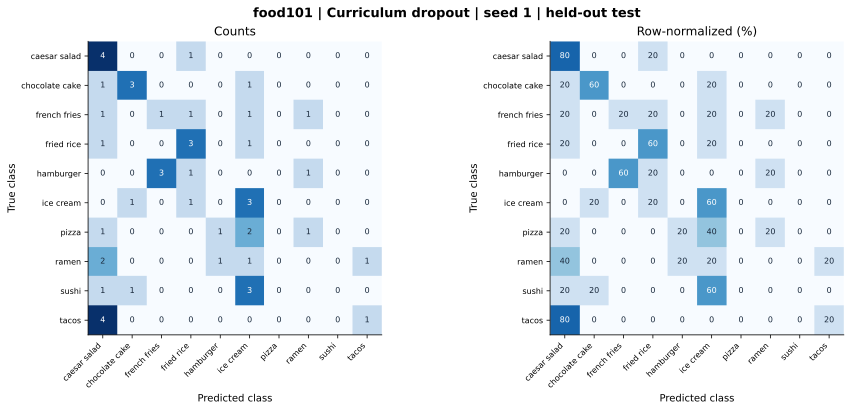

# food101 — Curriculum dropout — seed 1

Held-out test n=50; best validation checkpoint at epoch 2 (0-based).

| Metric | Score (%) |
|---|---:|
| accuracy | 30.00 |
| macro precision | 22.95 |
| macro recall | 30.00 |
| macro f1 | 23.61 |
| weighted f1 | 23.61 |
| micro f1 | 30.00 |
| balanced accuracy | 30.00 |

| Class | Precision (%) | Recall (%) | F1 (%) | Support |
|---|---:|---:|---:|---:|
| caesar_salad | 26.67 | 80.00 | 40.00 | 5 |
| chocolate_cake | 60.00 | 60.00 | 60.00 | 5 |
| french_fries | 25.00 | 20.00 | 22.22 | 5 |
| fried_rice | 42.86 | 60.00 | 50.00 | 5 |
| hamburger | 0.00 | 0.00 | 0.00 | 5 |
| ice_cream | 25.00 | 60.00 | 35.29 | 5 |
| pizza | 0.00 | 0.00 | 0.00 | 5 |
| ramen | 0.00 | 0.00 | 0.00 | 5 |
| sushi | 0.00 | 0.00 | 0.00 | 5 |
| tacos | 50.00 | 20.00 | 28.57 | 5 |

Undefined precision/recall uses zero. For single-label multiclass classification, micro-F1 equals accuracy and balanced accuracy equals macro recall.

[Raw test predictions](test_metrics.json) · [Training history](history.json) · [Config](config.json)
