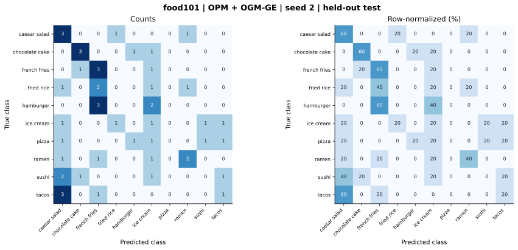

# food101 — OPM + OGM-GE (project) — seed 2

Held-out test n=50; best validation checkpoint at epoch 4 (0-based).

| Metric | Score (%) |
|---|---:|
| accuracy | 26.00 |
| macro precision | 20.11 |
| macro recall | 26.00 |
| macro f1 | 21.62 |
| weighted f1 | 21.62 |
| micro f1 | 26.00 |
| balanced accuracy | 26.00 |

| Class | Precision (%) | Recall (%) | F1 (%) | Support |
|---|---:|---:|---:|---:|
| caesar_salad | 25.00 | 60.00 | 35.29 | 5 |
| chocolate_cake | 60.00 | 60.00 | 60.00 | 5 |
| french_fries | 30.00 | 60.00 | 40.00 | 5 |
| fried_rice | 0.00 | 0.00 | 0.00 | 5 |
| hamburger | 0.00 | 0.00 | 0.00 | 5 |
| ice_cream | 11.11 | 20.00 | 14.29 | 5 |
| pizza | 0.00 | 0.00 | 0.00 | 5 |
| ramen | 50.00 | 40.00 | 44.44 | 5 |
| sushi | 0.00 | 0.00 | 0.00 | 5 |
| tacos | 25.00 | 20.00 | 22.22 | 5 |

Undefined precision/recall uses zero. For single-label multiclass classification, micro-F1 equals accuracy and balanced accuracy equals macro recall.

[Raw test predictions](test_metrics.json) · [Training history](history.json) · [Config](config.json)
