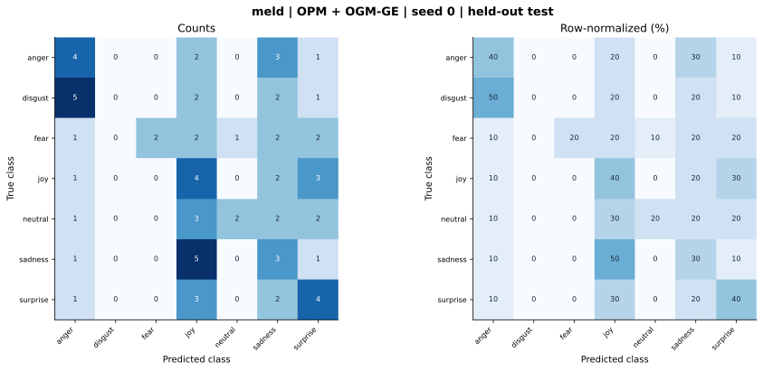

# meld — OPM + OGM-GE (project) — seed 0

Held-out test n=70; best validation checkpoint at epoch 2 (0-based).

| Metric | Score (%) |
|---|---:|
| accuracy | 27.14 |
| macro precision | 37.37 |
| macro recall | 27.14 |
| macro f1 | 25.66 |
| weighted f1 | 25.66 |
| micro f1 | 27.14 |
| balanced accuracy | 27.14 |

| Class | Precision (%) | Recall (%) | F1 (%) | Support |
|---|---:|---:|---:|---:|
| anger | 28.57 | 40.00 | 33.33 | 10 |
| disgust | 0.00 | 0.00 | 0.00 | 10 |
| fear | 100.00 | 20.00 | 33.33 | 10 |
| joy | 19.05 | 40.00 | 25.81 | 10 |
| neutral | 66.67 | 20.00 | 30.77 | 10 |
| sadness | 18.75 | 30.00 | 23.08 | 10 |
| surprise | 28.57 | 40.00 | 33.33 | 10 |

Undefined precision/recall uses zero. For single-label multiclass classification, micro-F1 equals accuracy and balanced accuracy equals macro recall.

[Raw test predictions](test_metrics.json) · [Training history](history.json) · [Config](config.json)
