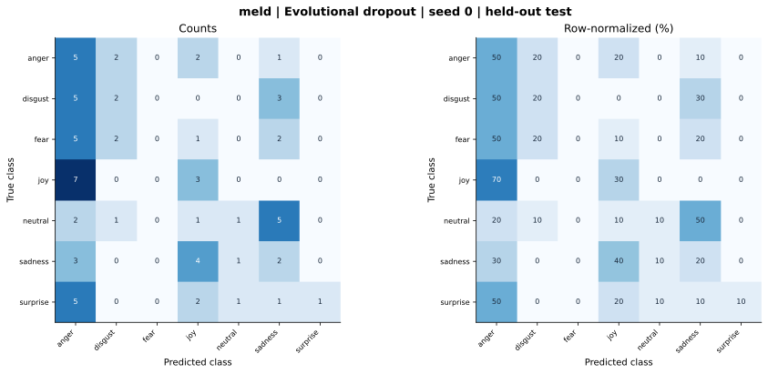

# meld — Evolutional dropout — seed 0

Held-out test n=70; best validation checkpoint at epoch 4 (0-based).

| Metric | Score (%) |
|---|---:|
| accuracy | 20.00 |
| macro precision | 30.70 |
| macro recall | 20.00 |
| macro f1 | 17.67 |
| weighted f1 | 17.67 |
| micro f1 | 20.00 |
| balanced accuracy | 20.00 |

| Class | Precision (%) | Recall (%) | F1 (%) | Support |
|---|---:|---:|---:|---:|
| anger | 15.62 | 50.00 | 23.81 | 10 |
| disgust | 28.57 | 20.00 | 23.53 | 10 |
| fear | 0.00 | 0.00 | 0.00 | 10 |
| joy | 23.08 | 30.00 | 26.09 | 10 |
| neutral | 33.33 | 10.00 | 15.38 | 10 |
| sadness | 14.29 | 20.00 | 16.67 | 10 |
| surprise | 100.00 | 10.00 | 18.18 | 10 |

Undefined precision/recall uses zero. For single-label multiclass classification, micro-F1 equals accuracy and balanced accuracy equals macro recall.

[Raw test predictions](test_metrics.json) · [Training history](history.json) · [Config](config.json)
