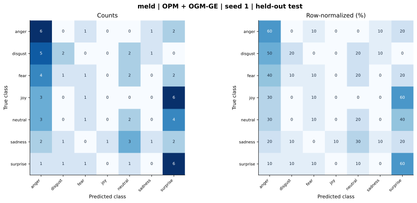

# meld — OPM + OGM-GE (project) — seed 1

Held-out test n=70; best validation checkpoint at epoch 4 (0-based).

| Metric | Score (%) |
|---|---:|
| accuracy | 25.71 |
| macro precision | 23.66 |
| macro recall | 25.71 |
| macro f1 | 21.17 |
| weighted f1 | 21.17 |
| micro f1 | 25.71 |
| balanced accuracy | 25.71 |

| Class | Precision (%) | Recall (%) | F1 (%) | Support |
|---|---:|---:|---:|---:|
| anger | 25.00 | 60.00 | 35.29 | 10 |
| disgust | 40.00 | 20.00 | 26.67 | 10 |
| fear | 20.00 | 10.00 | 13.33 | 10 |
| joy | 0.00 | 0.00 | 0.00 | 10 |
| neutral | 20.00 | 20.00 | 20.00 | 10 |
| sadness | 33.33 | 10.00 | 15.38 | 10 |
| surprise | 27.27 | 60.00 | 37.50 | 10 |

Undefined precision/recall uses zero. For single-label multiclass classification, micro-F1 equals accuracy and balanced accuracy equals macro recall.

[Raw test predictions](test_metrics.json) · [Training history](history.json) · [Config](config.json)
