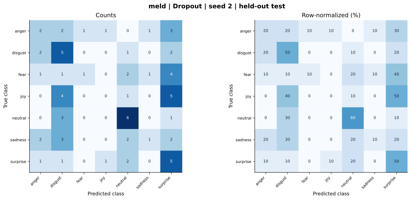

# meld — Dropout — seed 2

Held-out test n=70; best validation checkpoint at epoch 4 (0-based).

| Metric | Score (%) |
|---|---:|
| accuracy | 28.57 |
| macro precision | 28.60 |
| macro recall | 28.57 |
| macro f1 | 24.29 |
| weighted f1 | 24.29 |
| micro f1 | 28.57 |
| balanced accuracy | 28.57 |

| Class | Precision (%) | Recall (%) | F1 (%) | Support |
|---|---:|---:|---:|---:|
| anger | 25.00 | 20.00 | 22.22 | 10 |
| disgust | 26.32 | 50.00 | 34.48 | 10 |
| fear | 50.00 | 10.00 | 16.67 | 10 |
| joy | 0.00 | 0.00 | 0.00 | 10 |
| neutral | 42.86 | 60.00 | 50.00 | 10 |
| sadness | 33.33 | 10.00 | 15.38 | 10 |
| surprise | 22.73 | 50.00 | 31.25 | 10 |

Undefined precision/recall uses zero. For single-label multiclass classification, micro-F1 equals accuracy and balanced accuracy equals macro recall.

[Raw test predictions](test_metrics.json) · [Training history](history.json) · [Config](config.json)
