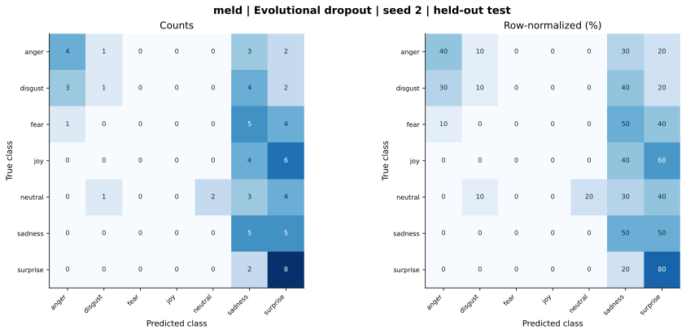

# meld — Evolutional dropout — seed 2

Held-out test n=70; best validation checkpoint at epoch 3 (0-based).

| Metric | Score (%) |
|---|---:|
| accuracy | 28.57 |
| macro precision | 32.62 |
| macro recall | 28.57 |
| macro f1 | 22.85 |
| weighted f1 | 22.85 |
| micro f1 | 28.57 |
| balanced accuracy | 28.57 |

| Class | Precision (%) | Recall (%) | F1 (%) | Support |
|---|---:|---:|---:|---:|
| anger | 50.00 | 40.00 | 44.44 | 10 |
| disgust | 33.33 | 10.00 | 15.38 | 10 |
| fear | 0.00 | 0.00 | 0.00 | 10 |
| joy | 0.00 | 0.00 | 0.00 | 10 |
| neutral | 100.00 | 20.00 | 33.33 | 10 |
| sadness | 19.23 | 50.00 | 27.78 | 10 |
| surprise | 25.81 | 80.00 | 39.02 | 10 |

Undefined precision/recall uses zero. For single-label multiclass classification, micro-F1 equals accuracy and balanced accuracy equals macro recall.

[Raw test predictions](test_metrics.json) · [Training history](history.json) · [Config](config.json)
