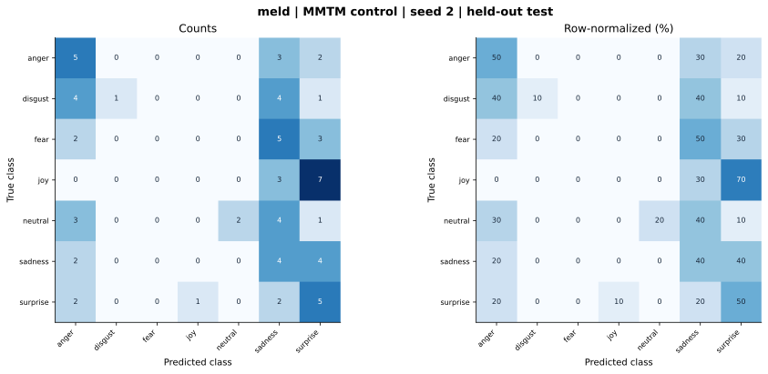

# meld — MMTM feature-level control — seed 2

Held-out test n=70; best validation checkpoint at epoch 2 (0-based).

| Metric | Score (%) |
|---|---:|
| accuracy | 24.29 |
| macro precision | 37.93 |
| macro recall | 24.29 |
| macro f1 | 20.06 |
| weighted f1 | 20.06 |
| micro f1 | 24.29 |
| balanced accuracy | 24.29 |

| Class | Precision (%) | Recall (%) | F1 (%) | Support |
|---|---:|---:|---:|---:|
| anger | 27.78 | 50.00 | 35.71 | 10 |
| disgust | 100.00 | 10.00 | 18.18 | 10 |
| fear | 0.00 | 0.00 | 0.00 | 10 |
| joy | 0.00 | 0.00 | 0.00 | 10 |
| neutral | 100.00 | 20.00 | 33.33 | 10 |
| sadness | 16.00 | 40.00 | 22.86 | 10 |
| surprise | 21.74 | 50.00 | 30.30 | 10 |

Undefined precision/recall uses zero. For single-label multiclass classification, micro-F1 equals accuracy and balanced accuracy equals macro recall.

[Raw test predictions](test_metrics.json) · [Training history](history.json) · [Config](config.json)
