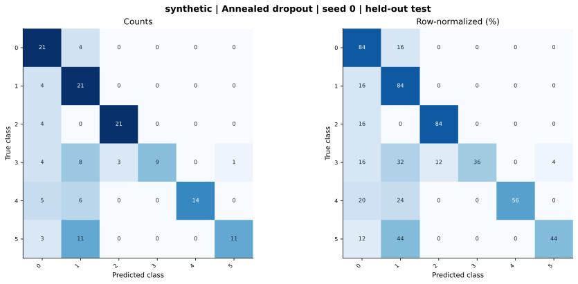

# synthetic — Annealed dropout — seed 0

Held-out test n=150; best validation checkpoint at epoch 3 (0-based).

| Metric | Score (%) |
|---|---:|
| accuracy | 64.67 |
| macro precision | 78.73 |
| macro recall | 64.67 |
| macro f1 | 64.92 |
| weighted f1 | 64.92 |
| micro f1 | 64.67 |
| balanced accuracy | 64.67 |

| Class | Precision (%) | Recall (%) | F1 (%) | Support |
|---|---:|---:|---:|---:|
| 0 | 51.22 | 84.00 | 63.64 | 25 |
| 1 | 42.00 | 84.00 | 56.00 | 25 |
| 2 | 87.50 | 84.00 | 85.71 | 25 |
| 3 | 100.00 | 36.00 | 52.94 | 25 |
| 4 | 100.00 | 56.00 | 71.79 | 25 |
| 5 | 91.67 | 44.00 | 59.46 | 25 |

Undefined precision/recall uses zero. For single-label multiclass classification, micro-F1 equals accuracy and balanced accuracy equals macro recall.

[Raw test predictions](test_metrics.json) · [Training history](history.json) · [Config](config.json)
