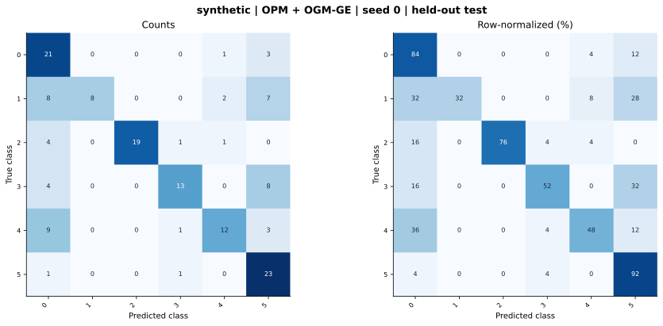

# synthetic — OPM + OGM-GE (project) — seed 0

Held-out test n=150; best validation checkpoint at epoch 4 (0-based).

| Metric | Score (%) |
|---|---:|
| accuracy | 64.00 |
| macro precision | 75.53 |
| macro recall | 64.00 |
| macro f1 | 63.63 |
| weighted f1 | 63.63 |
| micro f1 | 64.00 |
| balanced accuracy | 64.00 |

| Class | Precision (%) | Recall (%) | F1 (%) | Support |
|---|---:|---:|---:|---:|
| 0 | 44.68 | 84.00 | 58.33 | 25 |
| 1 | 100.00 | 32.00 | 48.48 | 25 |
| 2 | 100.00 | 76.00 | 86.36 | 25 |
| 3 | 81.25 | 52.00 | 63.41 | 25 |
| 4 | 75.00 | 48.00 | 58.54 | 25 |
| 5 | 52.27 | 92.00 | 66.67 | 25 |

Undefined precision/recall uses zero. For single-label multiclass classification, micro-F1 equals accuracy and balanced accuracy equals macro recall.

[Raw test predictions](test_metrics.json) · [Training history](history.json) · [Config](config.json)
