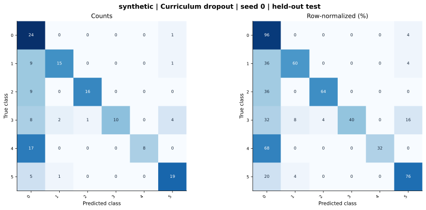

# synthetic — Curriculum dropout — seed 0

Held-out test n=150; best validation checkpoint at epoch 4 (0-based).

| Metric | Score (%) |
|---|---:|
| accuracy | 61.33 |
| macro precision | 81.13 |
| macro recall | 61.33 |
| macro f1 | 62.85 |
| weighted f1 | 62.85 |
| micro f1 | 61.33 |
| balanced accuracy | 61.33 |

| Class | Precision (%) | Recall (%) | F1 (%) | Support |
|---|---:|---:|---:|---:|
| 0 | 33.33 | 96.00 | 49.48 | 25 |
| 1 | 83.33 | 60.00 | 69.77 | 25 |
| 2 | 94.12 | 64.00 | 76.19 | 25 |
| 3 | 100.00 | 40.00 | 57.14 | 25 |
| 4 | 100.00 | 32.00 | 48.48 | 25 |
| 5 | 76.00 | 76.00 | 76.00 | 25 |

Undefined precision/recall uses zero. For single-label multiclass classification, micro-F1 equals accuracy and balanced accuracy equals macro recall.

[Raw test predictions](test_metrics.json) · [Training history](history.json) · [Config](config.json)
