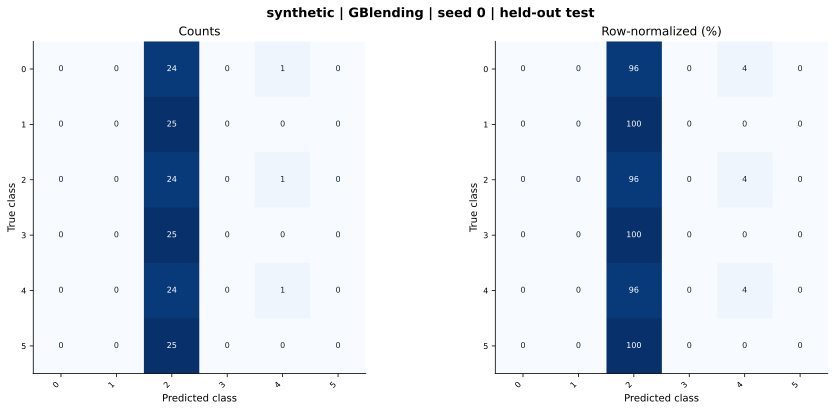

# synthetic — GBlending (offline adaptation) — seed 0

Held-out test n=150; best validation checkpoint at epoch 0 (0-based).

| Metric | Score (%) |
|---|---:|
| accuracy | 16.67 |
| macro precision | 8.28 |
| macro recall | 16.67 |
| macro f1 | 5.84 |
| weighted f1 | 5.84 |
| micro f1 | 16.67 |
| balanced accuracy | 16.67 |

| Class | Precision (%) | Recall (%) | F1 (%) | Support |
|---|---:|---:|---:|---:|
| 0 | 0.00 | 0.00 | 0.00 | 25 |
| 1 | 0.00 | 0.00 | 0.00 | 25 |
| 2 | 16.33 | 96.00 | 27.91 | 25 |
| 3 | 0.00 | 0.00 | 0.00 | 25 |
| 4 | 33.33 | 4.00 | 7.14 | 25 |
| 5 | 0.00 | 0.00 | 0.00 | 25 |

Undefined precision/recall uses zero. For single-label multiclass classification, micro-F1 equals accuracy and balanced accuracy equals macro recall.

[Raw test predictions](test_metrics.json) · [Training history](history.json) · [Config](config.json)
