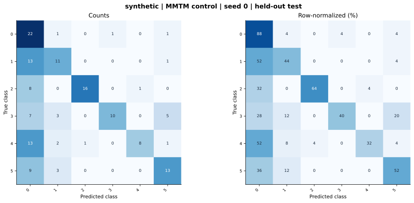

# synthetic — MMTM feature-level control — seed 0

Held-out test n=150; best validation checkpoint at epoch 4 (0-based).

| Metric | Score (%) |
|---|---:|
| accuracy | 53.33 |
| macro precision | 70.23 |
| macro recall | 53.33 |
| macro f1 | 54.93 |
| weighted f1 | 54.93 |
| micro f1 | 53.33 |
| balanced accuracy | 53.33 |

| Class | Precision (%) | Recall (%) | F1 (%) | Support |
|---|---:|---:|---:|---:|
| 0 | 30.56 | 88.00 | 45.36 | 25 |
| 1 | 55.00 | 44.00 | 48.89 | 25 |
| 2 | 94.12 | 64.00 | 76.19 | 25 |
| 3 | 90.91 | 40.00 | 55.56 | 25 |
| 4 | 88.89 | 32.00 | 47.06 | 25 |
| 5 | 61.90 | 52.00 | 56.52 | 25 |

Undefined precision/recall uses zero. For single-label multiclass classification, micro-F1 equals accuracy and balanced accuracy equals macro recall.

[Raw test predictions](test_metrics.json) · [Training history](history.json) · [Config](config.json)
