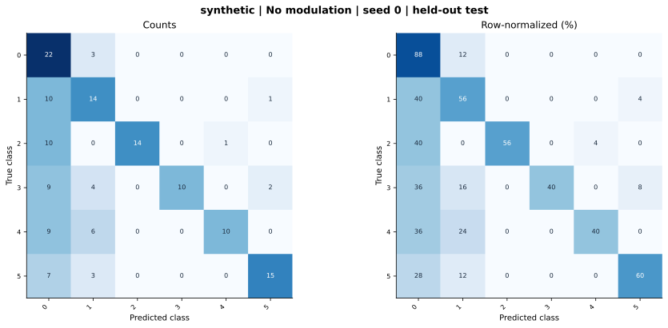

# synthetic — Concatenation / no modulation — seed 0

Held-out test n=150; best validation checkpoint at epoch 4 (0-based).

| Metric | Score (%) |
|---|---:|
| accuracy | 56.67 |
| macro precision | 75.62 |
| macro recall | 56.67 |
| macro f1 | 58.83 |
| weighted f1 | 58.83 |
| micro f1 | 56.67 |
| balanced accuracy | 56.67 |

| Class | Precision (%) | Recall (%) | F1 (%) | Support |
|---|---:|---:|---:|---:|
| 0 | 32.84 | 88.00 | 47.83 | 25 |
| 1 | 46.67 | 56.00 | 50.91 | 25 |
| 2 | 100.00 | 56.00 | 71.79 | 25 |
| 3 | 100.00 | 40.00 | 57.14 | 25 |
| 4 | 90.91 | 40.00 | 55.56 | 25 |
| 5 | 83.33 | 60.00 | 69.77 | 25 |

Undefined precision/recall uses zero. For single-label multiclass classification, micro-F1 equals accuracy and balanced accuracy equals macro recall.

[Raw test predictions](test_metrics.json) · [Training history](history.json) · [Config](config.json)
