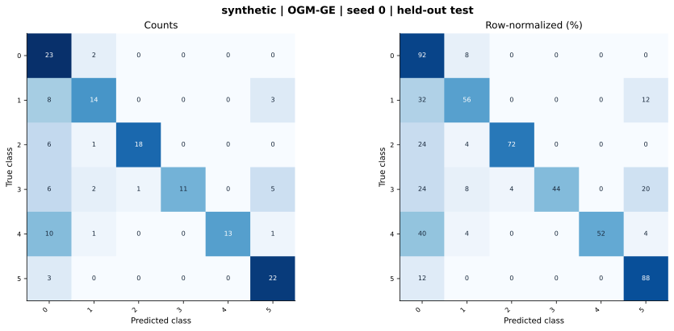

# synthetic — OGM-GE (project) — seed 0

Held-out test n=150; best validation checkpoint at epoch 4 (0-based).

| Metric | Score (%) |
|---|---:|
| accuracy | 67.33 |
| macro precision | 79.46 |
| macro recall | 67.33 |
| macro f1 | 68.16 |
| weighted f1 | 68.16 |
| micro f1 | 67.33 |
| balanced accuracy | 67.33 |

| Class | Precision (%) | Recall (%) | F1 (%) | Support |
|---|---:|---:|---:|---:|
| 0 | 41.07 | 92.00 | 56.79 | 25 |
| 1 | 70.00 | 56.00 | 62.22 | 25 |
| 2 | 94.74 | 72.00 | 81.82 | 25 |
| 3 | 100.00 | 44.00 | 61.11 | 25 |
| 4 | 100.00 | 52.00 | 68.42 | 25 |
| 5 | 70.97 | 88.00 | 78.57 | 25 |

Undefined precision/recall uses zero. For single-label multiclass classification, micro-F1 equals accuracy and balanced accuracy equals macro recall.

[Raw test predictions](test_metrics.json) · [Training history](history.json) · [Config](config.json)
