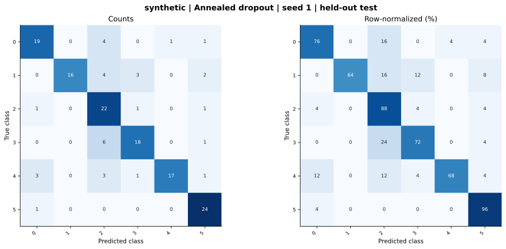

# synthetic — Annealed dropout — seed 1

Held-out test n=150; best validation checkpoint at epoch 4 (0-based).

| Metric | Score (%) |
|---|---:|
| accuracy | 77.33 |
| macro precision | 81.38 |
| macro recall | 77.33 |
| macro f1 | 77.62 |
| weighted f1 | 77.62 |
| micro f1 | 77.33 |
| balanced accuracy | 77.33 |

| Class | Precision (%) | Recall (%) | F1 (%) | Support |
|---|---:|---:|---:|---:|
| 0 | 79.17 | 76.00 | 77.55 | 25 |
| 1 | 100.00 | 64.00 | 78.05 | 25 |
| 2 | 56.41 | 88.00 | 68.75 | 25 |
| 3 | 78.26 | 72.00 | 75.00 | 25 |
| 4 | 94.44 | 68.00 | 79.07 | 25 |
| 5 | 80.00 | 96.00 | 87.27 | 25 |

Undefined precision/recall uses zero. For single-label multiclass classification, micro-F1 equals accuracy and balanced accuracy equals macro recall.

[Raw test predictions](test_metrics.json) · [Training history](history.json) · [Config](config.json)
