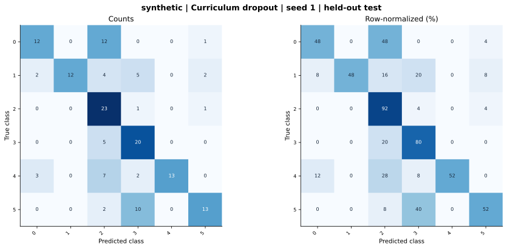

# synthetic — Curriculum dropout — seed 1

Held-out test n=150; best validation checkpoint at epoch 4 (0-based).

| Metric | Score (%) |
|---|---:|
| accuracy | 62.00 |
| macro precision | 73.85 |
| macro recall | 62.00 |
| macro f1 | 62.47 |
| weighted f1 | 62.47 |
| micro f1 | 62.00 |
| balanced accuracy | 62.00 |

| Class | Precision (%) | Recall (%) | F1 (%) | Support |
|---|---:|---:|---:|---:|
| 0 | 70.59 | 48.00 | 57.14 | 25 |
| 1 | 100.00 | 48.00 | 64.86 | 25 |
| 2 | 43.40 | 92.00 | 58.97 | 25 |
| 3 | 52.63 | 80.00 | 63.49 | 25 |
| 4 | 100.00 | 52.00 | 68.42 | 25 |
| 5 | 76.47 | 52.00 | 61.90 | 25 |

Undefined precision/recall uses zero. For single-label multiclass classification, micro-F1 equals accuracy and balanced accuracy equals macro recall.

[Raw test predictions](test_metrics.json) · [Training history](history.json) · [Config](config.json)
