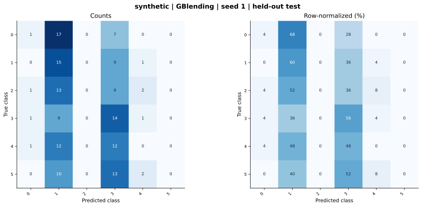

# synthetic — GBlending (offline adaptation) — seed 1

Held-out test n=150; best validation checkpoint at epoch 2 (0-based).

| Metric | Score (%) |
|---|---:|
| accuracy | 20.00 |
| macro precision | 11.10 |
| macro recall | 20.00 |
| macro f1 | 11.34 |
| weighted f1 | 11.34 |
| micro f1 | 20.00 |
| balanced accuracy | 20.00 |

| Class | Precision (%) | Recall (%) | F1 (%) | Support |
|---|---:|---:|---:|---:|
| 0 | 25.00 | 4.00 | 6.90 | 25 |
| 1 | 19.74 | 60.00 | 29.70 | 25 |
| 2 | 0.00 | 0.00 | 0.00 | 25 |
| 3 | 21.88 | 56.00 | 31.46 | 25 |
| 4 | 0.00 | 0.00 | 0.00 | 25 |
| 5 | 0.00 | 0.00 | 0.00 | 25 |

Undefined precision/recall uses zero. For single-label multiclass classification, micro-F1 equals accuracy and balanced accuracy equals macro recall.

[Raw test predictions](test_metrics.json) · [Training history](history.json) · [Config](config.json)
