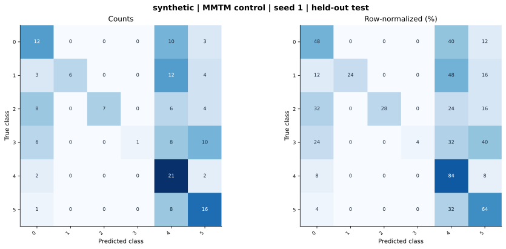

# synthetic — MMTM feature-level control — seed 1

Held-out test n=150; best validation checkpoint at epoch 3 (0-based).

| Metric | Score (%) |
|---|---:|
| accuracy | 42.00 |
| macro precision | 68.47 |
| macro recall | 42.00 |
| macro f1 | 38.15 |
| weighted f1 | 38.15 |
| micro f1 | 42.00 |
| balanced accuracy | 42.00 |

| Class | Precision (%) | Recall (%) | F1 (%) | Support |
|---|---:|---:|---:|---:|
| 0 | 37.50 | 48.00 | 42.11 | 25 |
| 1 | 100.00 | 24.00 | 38.71 | 25 |
| 2 | 100.00 | 28.00 | 43.75 | 25 |
| 3 | 100.00 | 4.00 | 7.69 | 25 |
| 4 | 32.31 | 84.00 | 46.67 | 25 |
| 5 | 41.03 | 64.00 | 50.00 | 25 |

Undefined precision/recall uses zero. For single-label multiclass classification, micro-F1 equals accuracy and balanced accuracy equals macro recall.

[Raw test predictions](test_metrics.json) · [Training history](history.json) · [Config](config.json)
