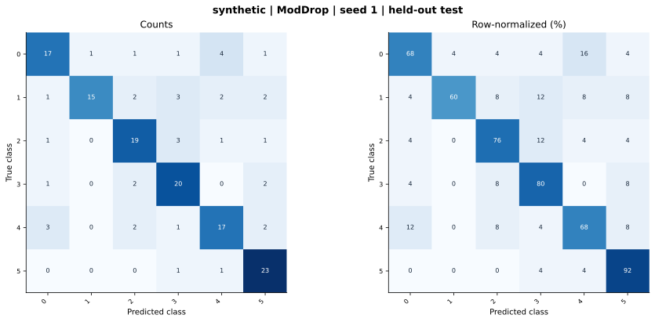

# synthetic — ModDrop (feature adaptation) — seed 1

Held-out test n=150; best validation checkpoint at epoch 4 (0-based).

| Metric | Score (%) |
|---|---:|
| accuracy | 74.00 |
| macro precision | 75.32 |
| macro recall | 74.00 |
| macro f1 | 73.79 |
| weighted f1 | 73.79 |
| micro f1 | 74.00 |
| balanced accuracy | 74.00 |

| Class | Precision (%) | Recall (%) | F1 (%) | Support |
|---|---:|---:|---:|---:|
| 0 | 73.91 | 68.00 | 70.83 | 25 |
| 1 | 93.75 | 60.00 | 73.17 | 25 |
| 2 | 73.08 | 76.00 | 74.51 | 25 |
| 3 | 68.97 | 80.00 | 74.07 | 25 |
| 4 | 68.00 | 68.00 | 68.00 | 25 |
| 5 | 74.19 | 92.00 | 82.14 | 25 |

Undefined precision/recall uses zero. For single-label multiclass classification, micro-F1 equals accuracy and balanced accuracy equals macro recall.

[Raw test predictions](test_metrics.json) · [Training history](history.json) · [Config](config.json)
