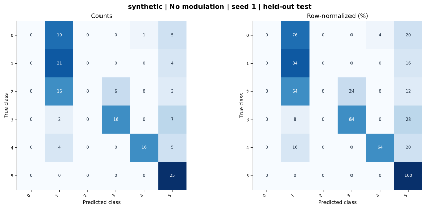

# synthetic — Concatenation / no modulation — seed 1

Held-out test n=150; best validation checkpoint at epoch 2 (0-based).

| Metric | Score (%) |
|---|---:|
| accuracy | 52.00 |
| macro precision | 41.96 |
| macro recall | 52.00 |
| macro f1 | 43.35 |
| weighted f1 | 43.35 |
| micro f1 | 52.00 |
| balanced accuracy | 52.00 |

| Class | Precision (%) | Recall (%) | F1 (%) | Support |
|---|---:|---:|---:|---:|
| 0 | 0.00 | 0.00 | 0.00 | 25 |
| 1 | 33.87 | 84.00 | 48.28 | 25 |
| 2 | 0.00 | 0.00 | 0.00 | 25 |
| 3 | 72.73 | 64.00 | 68.09 | 25 |
| 4 | 94.12 | 64.00 | 76.19 | 25 |
| 5 | 51.02 | 100.00 | 67.57 | 25 |

Undefined precision/recall uses zero. For single-label multiclass classification, micro-F1 equals accuracy and balanced accuracy equals macro recall.

[Raw test predictions](test_metrics.json) · [Training history](history.json) · [Config](config.json)
