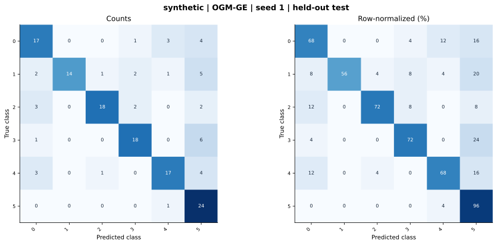

# synthetic — OGM-GE (project) — seed 1

Held-out test n=150; best validation checkpoint at epoch 4 (0-based).

| Metric | Score (%) |
|---|---:|
| accuracy | 72.00 |
| macro precision | 77.38 |
| macro recall | 72.00 |
| macro f1 | 72.40 |
| weighted f1 | 72.40 |
| micro f1 | 72.00 |
| balanced accuracy | 72.00 |

| Class | Precision (%) | Recall (%) | F1 (%) | Support |
|---|---:|---:|---:|---:|
| 0 | 65.38 | 68.00 | 66.67 | 25 |
| 1 | 100.00 | 56.00 | 71.79 | 25 |
| 2 | 90.00 | 72.00 | 80.00 | 25 |
| 3 | 78.26 | 72.00 | 75.00 | 25 |
| 4 | 77.27 | 68.00 | 72.34 | 25 |
| 5 | 53.33 | 96.00 | 68.57 | 25 |

Undefined precision/recall uses zero. For single-label multiclass classification, micro-F1 equals accuracy and balanced accuracy equals macro recall.

[Raw test predictions](test_metrics.json) · [Training history](history.json) · [Config](config.json)
