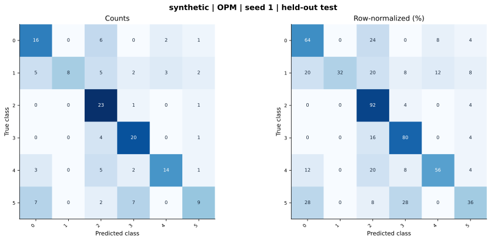

# synthetic — OPM (project) — seed 1

Held-out test n=150; best validation checkpoint at epoch 4 (0-based).

| Metric | Score (%) |
|---|---:|
| accuracy | 60.00 |
| macro precision | 66.48 |
| macro recall | 60.00 |
| macro f1 | 58.36 |
| weighted f1 | 58.36 |
| micro f1 | 60.00 |
| balanced accuracy | 60.00 |

| Class | Precision (%) | Recall (%) | F1 (%) | Support |
|---|---:|---:|---:|---:|
| 0 | 51.61 | 64.00 | 57.14 | 25 |
| 1 | 100.00 | 32.00 | 48.48 | 25 |
| 2 | 51.11 | 92.00 | 65.71 | 25 |
| 3 | 62.50 | 80.00 | 70.18 | 25 |
| 4 | 73.68 | 56.00 | 63.64 | 25 |
| 5 | 60.00 | 36.00 | 45.00 | 25 |

Undefined precision/recall uses zero. For single-label multiclass classification, micro-F1 equals accuracy and balanced accuracy equals macro recall.

[Raw test predictions](test_metrics.json) · [Training history](history.json) · [Config](config.json)
