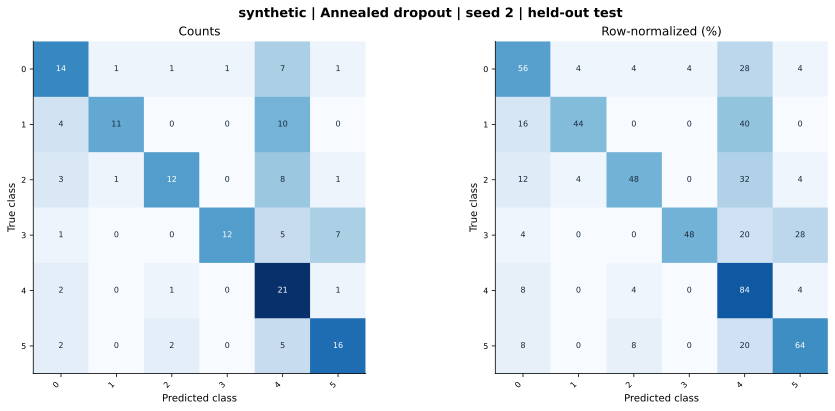

# synthetic — Annealed dropout — seed 2

Held-out test n=150; best validation checkpoint at epoch 4 (0-based).

| Metric | Score (%) |
|---|---:|
| accuracy | 57.33 |
| macro precision | 67.47 |
| macro recall | 57.33 |
| macro f1 | 58.18 |
| weighted f1 | 58.18 |
| micro f1 | 57.33 |
| balanced accuracy | 57.33 |

| Class | Precision (%) | Recall (%) | F1 (%) | Support |
|---|---:|---:|---:|---:|
| 0 | 53.85 | 56.00 | 54.90 | 25 |
| 1 | 84.62 | 44.00 | 57.89 | 25 |
| 2 | 75.00 | 48.00 | 58.54 | 25 |
| 3 | 92.31 | 48.00 | 63.16 | 25 |
| 4 | 37.50 | 84.00 | 51.85 | 25 |
| 5 | 61.54 | 64.00 | 62.75 | 25 |

Undefined precision/recall uses zero. For single-label multiclass classification, micro-F1 equals accuracy and balanced accuracy equals macro recall.

[Raw test predictions](test_metrics.json) · [Training history](history.json) · [Config](config.json)
