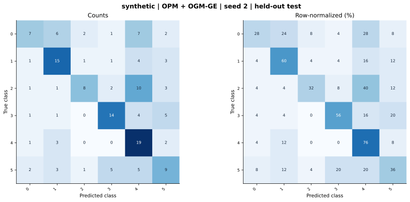

# synthetic — OPM + OGM-GE (project) — seed 2

Held-out test n=150; best validation checkpoint at epoch 4 (0-based).

| Metric | Score (%) |
|---|---:|
| accuracy | 48.00 |
| macro precision | 51.56 |
| macro recall | 48.00 |
| macro f1 | 47.01 |
| weighted f1 | 47.01 |
| micro f1 | 48.00 |
| balanced accuracy | 48.00 |

| Class | Precision (%) | Recall (%) | F1 (%) | Support |
|---|---:|---:|---:|---:|
| 0 | 53.85 | 28.00 | 36.84 | 25 |
| 1 | 51.72 | 60.00 | 55.56 | 25 |
| 2 | 66.67 | 32.00 | 43.24 | 25 |
| 3 | 60.87 | 56.00 | 58.33 | 25 |
| 4 | 38.78 | 76.00 | 51.35 | 25 |
| 5 | 37.50 | 36.00 | 36.73 | 25 |

Undefined precision/recall uses zero. For single-label multiclass classification, micro-F1 equals accuracy and balanced accuracy equals macro recall.

[Raw test predictions](test_metrics.json) · [Training history](history.json) · [Config](config.json)
