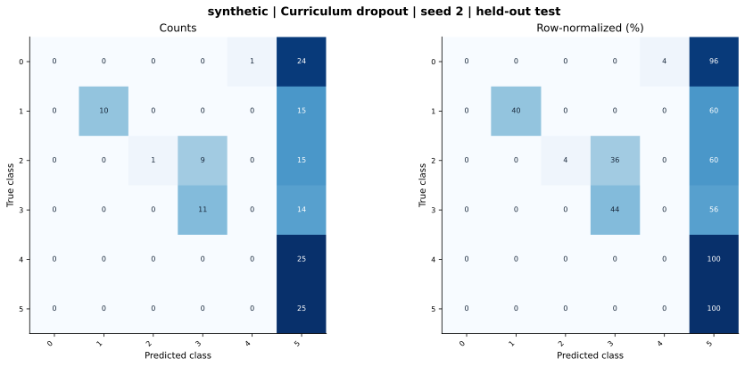

# synthetic — Curriculum dropout — seed 2

Held-out test n=150; best validation checkpoint at epoch 3 (0-based).

| Metric | Score (%) |
|---|---:|
| accuracy | 31.33 |
| macro precision | 46.03 |
| macro recall | 31.33 |
| macro f1 | 24.78 |
| weighted f1 | 24.78 |
| micro f1 | 31.33 |
| balanced accuracy | 31.33 |

| Class | Precision (%) | Recall (%) | F1 (%) | Support |
|---|---:|---:|---:|---:|
| 0 | 0.00 | 0.00 | 0.00 | 25 |
| 1 | 100.00 | 40.00 | 57.14 | 25 |
| 2 | 100.00 | 4.00 | 7.69 | 25 |
| 3 | 55.00 | 44.00 | 48.89 | 25 |
| 4 | 0.00 | 0.00 | 0.00 | 25 |
| 5 | 21.19 | 100.00 | 34.97 | 25 |

Undefined precision/recall uses zero. For single-label multiclass classification, micro-F1 equals accuracy and balanced accuracy equals macro recall.

[Raw test predictions](test_metrics.json) · [Training history](history.json) · [Config](config.json)
