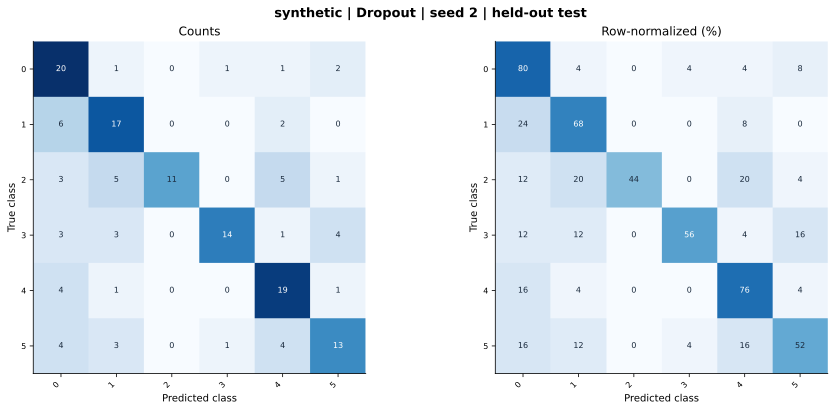

# synthetic — Dropout — seed 2

Held-out test n=150; best validation checkpoint at epoch 4 (0-based).

| Metric | Score (%) |
|---|---:|
| accuracy | 62.67 |
| macro precision | 69.24 |
| macro recall | 62.67 |
| macro f1 | 62.66 |
| weighted f1 | 62.66 |
| micro f1 | 62.67 |
| balanced accuracy | 62.67 |

| Class | Precision (%) | Recall (%) | F1 (%) | Support |
|---|---:|---:|---:|---:|
| 0 | 50.00 | 80.00 | 61.54 | 25 |
| 1 | 56.67 | 68.00 | 61.82 | 25 |
| 2 | 100.00 | 44.00 | 61.11 | 25 |
| 3 | 87.50 | 56.00 | 68.29 | 25 |
| 4 | 59.38 | 76.00 | 66.67 | 25 |
| 5 | 61.90 | 52.00 | 56.52 | 25 |

Undefined precision/recall uses zero. For single-label multiclass classification, micro-F1 equals accuracy and balanced accuracy equals macro recall.

[Raw test predictions](test_metrics.json) · [Training history](history.json) · [Config](config.json)
