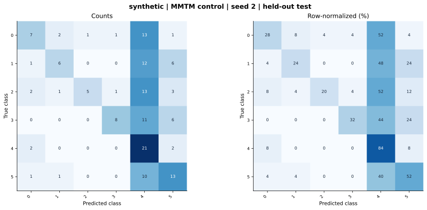

# synthetic — MMTM feature-level control — seed 2

Held-out test n=150; best validation checkpoint at epoch 4 (0-based).

| Metric | Score (%) |
|---|---:|
| accuracy | 40.00 |
| macro precision | 57.56 |
| macro recall | 40.00 |
| macro f1 | 39.25 |
| weighted f1 | 39.25 |
| micro f1 | 40.00 |
| balanced accuracy | 40.00 |

| Class | Precision (%) | Recall (%) | F1 (%) | Support |
|---|---:|---:|---:|---:|
| 0 | 53.85 | 28.00 | 36.84 | 25 |
| 1 | 60.00 | 24.00 | 34.29 | 25 |
| 2 | 83.33 | 20.00 | 32.26 | 25 |
| 3 | 80.00 | 32.00 | 45.71 | 25 |
| 4 | 26.25 | 84.00 | 40.00 | 25 |
| 5 | 41.94 | 52.00 | 46.43 | 25 |

Undefined precision/recall uses zero. For single-label multiclass classification, micro-F1 equals accuracy and balanced accuracy equals macro recall.

[Raw test predictions](test_metrics.json) · [Training history](history.json) · [Config](config.json)
