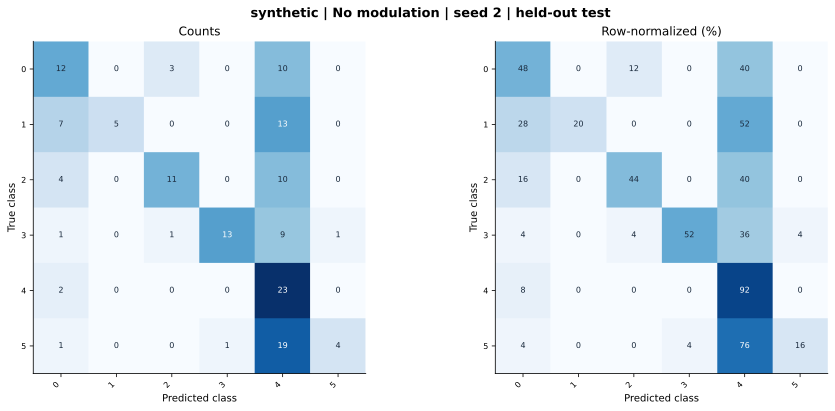

# synthetic — Concatenation / no modulation — seed 2

Held-out test n=150; best validation checkpoint at epoch 4 (0-based).

| Metric | Score (%) |
|---|---:|
| accuracy | 45.33 |
| macro precision | 69.67 |
| macro recall | 45.33 |
| macro f1 | 45.00 |
| weighted f1 | 45.00 |
| micro f1 | 45.33 |
| balanced accuracy | 45.33 |

| Class | Precision (%) | Recall (%) | F1 (%) | Support |
|---|---:|---:|---:|---:|
| 0 | 44.44 | 48.00 | 46.15 | 25 |
| 1 | 100.00 | 20.00 | 33.33 | 25 |
| 2 | 73.33 | 44.00 | 55.00 | 25 |
| 3 | 92.86 | 52.00 | 66.67 | 25 |
| 4 | 27.38 | 92.00 | 42.20 | 25 |
| 5 | 80.00 | 16.00 | 26.67 | 25 |

Undefined precision/recall uses zero. For single-label multiclass classification, micro-F1 equals accuracy and balanced accuracy equals macro recall.

[Raw test predictions](test_metrics.json) · [Training history](history.json) · [Config](config.json)
