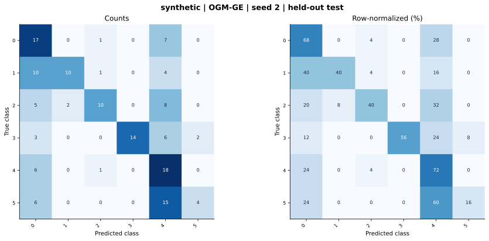

# synthetic — OGM-GE (project) — seed 2

Held-out test n=150; best validation checkpoint at epoch 4 (0-based).

| Metric | Score (%) |
|---|---:|
| accuracy | 48.67 |
| macro precision | 65.69 |
| macro recall | 48.67 |
| macro f1 | 49.15 |
| weighted f1 | 49.15 |
| micro f1 | 48.67 |
| balanced accuracy | 48.67 |

| Class | Precision (%) | Recall (%) | F1 (%) | Support |
|---|---:|---:|---:|---:|
| 0 | 36.17 | 68.00 | 47.22 | 25 |
| 1 | 83.33 | 40.00 | 54.05 | 25 |
| 2 | 76.92 | 40.00 | 52.63 | 25 |
| 3 | 100.00 | 56.00 | 71.79 | 25 |
| 4 | 31.03 | 72.00 | 43.37 | 25 |
| 5 | 66.67 | 16.00 | 25.81 | 25 |

Undefined precision/recall uses zero. For single-label multiclass classification, micro-F1 equals accuracy and balanced accuracy equals macro recall.

[Raw test predictions](test_metrics.json) · [Training history](history.json) · [Config](config.json)
