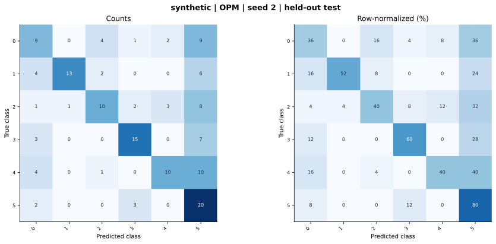

# synthetic — OPM (project) — seed 2

Held-out test n=150; best validation checkpoint at epoch 4 (0-based).

| Metric | Score (%) |
|---|---:|
| accuracy | 51.33 |
| macro precision | 60.37 |
| macro recall | 51.33 |
| macro f1 | 52.34 |
| weighted f1 | 52.34 |
| micro f1 | 51.33 |
| balanced accuracy | 51.33 |

| Class | Precision (%) | Recall (%) | F1 (%) | Support |
|---|---:|---:|---:|---:|
| 0 | 39.13 | 36.00 | 37.50 | 25 |
| 1 | 92.86 | 52.00 | 66.67 | 25 |
| 2 | 58.82 | 40.00 | 47.62 | 25 |
| 3 | 71.43 | 60.00 | 65.22 | 25 |
| 4 | 66.67 | 40.00 | 50.00 | 25 |
| 5 | 33.33 | 80.00 | 47.06 | 25 |

Undefined precision/recall uses zero. For single-label multiclass classification, micro-F1 equals accuracy and balanced accuracy equals macro recall.

[Raw test predictions](test_metrics.json) · [Training history](history.json) · [Config](config.json)
